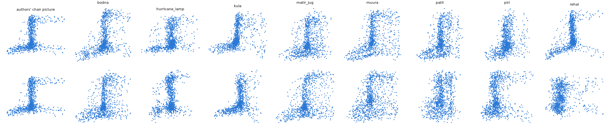

# 06 · RGB2Point: web images → point clouds

Shahedul's idea: we cannot scan 100 bodnas, so collect ~100 photos per object from the web and let **RGB2Point** (a model that guesses a 3D point cloud from one photo) turn each into a point cloud. Notebook: [`notebooks/rgb2point.ipynb`](../notebooks/rgb2point.ipynb).

## 2026-11-16 · Claude · the Google Images step returned nothing; replaced with Bing + DuckDuckGo

**What the notebook says about itself (not checked by us):**
- It uses the released RGB2Point checkpoint `pc1024_three.pth` from <https://github.com/JaeLee18/RGB2point>, without training.
- That checkpoint outputs 1,024 xyz points with no colour. Its training domain is ShapeNet chairs, airplanes and cars.
- The 8,192-point files are the same 1,024 points with extra points interpolated between neighbours. That adds points, not detail.

**What we measured (laptop, 2026-11-16, query "Wooden Bench Bangladesh", 30 images asked):**

| Source | Result |
|---|---|
| Google Images via `icrawler` `GoogleImageCrawler` | **0 files**; the crawler got no result list at all |
| Bing Images via `icrawler` `BingImageCrawler` | 30 files in 12 s |
| DuckDuckGo Images via `ddgs` | 30 results in 1 s |
| Openverse API (openly licensed images only) | 1 result |
| Wikimedia Commons API | 3 results |

Google answers image searches only for real browsers, so a script gets nothing. We do not try to get around that. Openverse and Wikimedia would give clear licences but have almost no pictures of our objects.

**The fix (download cell of the notebook):**
- `IMAGE_SOURCES = ["bing", "duckduckgo"]`, tried in order. It searches "<object> Bangladesh" first and then the plain name, until `TARGET_IMAGES` is reached. A failing source is skipped, not fatal.
- Own images: `OWN_IMAGES_DIR` or `UPLOAD_OWN_IMAGES` (a ZIP or files), for pictures saved by hand from Google or taken ourselves. They are used first.
- The manifest now records `image_source`, `search_query`, `source_url` and `source_page` per image.
- `pip` output is no longer hidden.

**Tests of the new cell (laptop):**

| Query | Images kept | From | Time |
|---|---|---|---|
| Wooden Bench | 100 / 100 | Bing 74, DuckDuckGo 26 | 69 s |
| Bodna | 100 / 100 | Bing 90, DuckDuckGo 10 | 88 s |

Looking at the 100 bodna pictures by eye: about **65 show a real bodna**. The rest are noise, mostly news pictures about "bonds" and Bangladesh Bank that Bing mixes in for "Bodna", plus a few other jugs and bins. Several good ones show two or more bodnas, or have advert text on them. So the manual review step in the notebook is needed, and 100 downloads will not mean 100 usable images.

**Not tested yet:**
- The notebook on Colab. Colab machines share addresses with many other users, so a search site may rate-limit there even though it worked on the laptop.
- The RGB2Point conversion cells (they need the checkpoint; we did not change them).
- Whether RGB2Point gives a believable shape for a bodna at all. It was trained on chairs, airplanes and cars, so this is the real open question. Check the one-image smoke test before making 100 clouds.

**Keep in mind:**
- Web images have unknown licences. Do not commit them to git, and check before sharing a dataset.
- These point clouds are a model's guess from one photo, not scans. Keep them separate from our Scaniverse scans in every table.

## 2026-11-17 · Claude · pictures collected on the laptop; RGB2Point makes the same chair-like cloud for every object

**Why:** searching inside Colab was slow and unreliable, so the plan became: collect the pictures once on the laptop, put them on Drive, and let the notebook only run the model ("Part B" of `notebooks/rgb2point.ipynb`).

**Collecting (laptop):** `src/web_images.py` with the search phrases in `data/web_image_queries.csv`. Pictures go to `data/web_images/<object>/` (not in git), shrunk to 640 px, with a `manifest.csv` of source URLs. Wrong pictures are moved to `data/web_images/_rejected/` after looking at numbered overview sheets.

| Object | Downloaded | Kept after review by eye |
|---|---|---|
| bodna | 250 | 88 |
| hurricane_lamp | 250 | 79 |
| kula | 250 | 60 |
| matir_jug | 250 | 72 |
| muura | 250 | 103 |
| patil | 250 | 34 |
| piri | 250 | 19 |
| rehal | 250 | 98 |
| wooden_benched | 250 | 142 |
| **total** | 2,250 | **695** |

About **1 picture in 3 is usable** (695 of 2,250). The rest are other objects, people, adverts with text, collages, or the wrong kind of the object:
- "bodna" brings news about bonds and video thumbnails.
- "kula" brings round trays.
- "matir jug" brings plastic and steel jugs.
- "hurricane lamp" brings candle holders.
- "patil" brings aluminium sheets, factories and Western saucepans. We kept only round-bellied pots.
- "piri" brings chapati boards with rolling pins, Western stools and woven Indian stools. Plain Bangladeshi wooden piris are rare online: 19 kept, most of them painted wedding piris. Whether woven "pidha" stools count as piri is our decision to make.

English descriptive phrases ("terracotta water jug", "bamboo cane mora stool") gave far better pictures than the local names. Bing often returned nothing for a phrase; DuckDuckGo carried most of the load, about 35 results per page.

**Testing the model (laptop CPU, released checkpoint `pc1024_three.pth`, the notebook's own cells):**
- Part B ran end to end on 8 pictures. A second run skipped the finished ones. The `_rejected` folder was ignored.
- Bug fixed on the way: the setup cell failed when run twice, because it tried to patch `model.py` a second time.

**The result that matters:** every object comes out as the same fuzzy, chair-like cloud. From the side, the authors' own chair picture gives a clear seat-and-back "L", and so do many of the bodna, lamp, kula and rehal pictures; the rest are shapeless.

*Left: the authors' chair sample. Then two pictures per object. No web pictures are shown, only the model's output.*

We measured it with the **Chamfer distance** (for each point, the distance to the nearest point of the other cloud, averaged; 0 = identical clouds). 20 pictures per object, 8 objects; clouds are about 1.02 across. Patil, piri and rehal used unreviewed pictures. Table: `results/rgb2point/chamfer_within_vs_between_2026-11-17.csv`.

| | Chamfer distance |
|---|---|
| two pictures of the **same** object | 0.023 – 0.035 |
| pictures of **different** objects | 0.028 – 0.032 |
| our objects vs the authors' chair cloud | 0.024 – 0.031 |

The three ranges are the same. If the clouds held the object's shape, the first row would be clearly smaller than the second. It is not: for piri it is even larger.

**What it means:** this checkpoint knows chairs, airplanes and cars (as its authors say). For anything else it falls back to its nearest known shape. Its clouds for our objects are not 3D data of those objects. Feeding them to PointLLM would test "does PointLLM see a chair", not our objects. Interpolating to 8,192 points changes nothing about this.

**What the pictures are still good for:** they are real photos of the objects, so they fit the image side of the project: CLIP / MetaCLIP zero-shot on photos, or fine-tuning with captions.

**If we still want 3D from photos:** use a single-image-to-3D model trained on many kinds of objects (for example TripoSR, which was trained on Objaverse), not this three-class checkpoint. Not tried yet. Its shapes would still be a model's guess, not scans.

**State on 2026-11-17, end of first pass:** all 9 objects downloaded and reviewed once. Only muura and wooden bench have 100 or more good pictures. Extra search phrases for the others are already in `data/web_image_queries.csv`; running `collect` again with a higher `--target` tops them up without bringing rejected pictures back. Not done yet, because the RGB2Point result above makes it unclear what the pictures will be used for.

## 2026-11-17 (later) · Claude · RGB2Point on all 695 photos + control: the clouds DO carry some object information (correction)

Report: [`reports/2026-11-17_rgb2point_web_images/report.md`](../reports/2026-11-17_rgb2point_web_images/report.md) (+ PDF). Code: `reports/build/rgb2point_eval.py`. Tables: `results/rgb2point/*_2026-11-17.csv`.

**What ran (laptop CPU, about 5 minutes):**
- RGB2Point on all 695 reviewed photos.
- A control of 93 photos of chairs (40) and airplanes (53), classes the checkpoint was trained on (phrases in `data/web_image_control_queries.csv`).
- For the distance test: up to 40 photos per class, random with seed 0.

**Correction to the entry above.** The average Chamfer distance is still about the same within and between objects (ratio 1.0–1.2; control 1.3). But the stricter question, "is a cloud's *most similar* cloud the same object?", says otherwise:

| Test | Result |
|---|---|
| 9 objects at once, nearest cloud = same object | **70 %** (guessing 11 %) |
| 2 objects at a time (36 pairs) | 81–100 %, median 91 % |
| chair vs airplane (control) | 100 % |
| same 9-object test, near-copy photos not allowed as partner | 68 % |
| no 3D at all: nearest photo by 32×32 colour thumbnail | 42 % |

Only 5 % of the matches were near-copies of the same photo. So the clouds do keep something specific to each object, more than raw pixels do. Hardest objects: piri 47 % and kula 48 %. Easiest: bodna and hurricane lamp, 80 % each.

**Updated reading:**
- The clouds still *look* like chairs and do not show the real shape of our objects.
- But they work as a fingerprint of what the photo showed. The image encoder (a ViT) recognises something, and the decoder bends the chair template a little, the same way each time.
- So: still not usable as 3D data or as PointLLM input "as our objects". The 70 % comes from image recognition, not from 3D shape.
- The photos themselves are the useful part (CLIP).

**TripoSR** (photo → mesh, trained on Objaverse) was set up locally but ran out of resources on the CPU-only laptop. The user stopped it. If wanted later, it needs Colab with a GPU.

## 2026-11-21 · team (Colab run) + Claude (report) · TripoSR on 675 web photos: shapes look right, but the backgrounds were rebuilt too

Report: [`reports/2026-11-21_triposr_web_images/report.md`](../reports/2026-11-21_triposr_web_images/report.md) (+ PDF). Notebook: `notebooks/triposr.ipynb` (renamed from `{Updated}TripoSR_Images_to_3D_to_PointClouds.ipynb`). The notebook's own batch log is kept as `reports/2026-11-21_triposr_web_images/batch_log.pdf`. Tables parsed from it: `results/triposr/`.

**What ran (Colab T4):** TripoSR (`stabilityai/TripoSR`, trained on Objaverse) on 675 photos of 8 objects → coloured mesh → 8,192 points sampled on the surface, coloured from the mesh. Settings: marching cubes 192, `REMOVE_BACKGROUND = False`, `NORMALIZE_POINTCLOUD = False`, upright as in TripoSR's demo, seed 0.

**Measured (from the log):**
- 675 / 675 meshes and clouds, all exactly 8,192 points; 602 meshes (89 %) watertight
- about 3 s per photo, 27.6 min in total (bodna and hurricane lamp were made in an earlier session)
- point spacing 0.008–0.009 for every object, so the clouds are evenly filled

**Seen in the 40 previews (all bodna):**
- 27 one object on a light background: body, neck, spout and handle all there, but most with a pale halo of background points
- 5 coloured or scene backgrounds rebuilt as a slab
- 4 with the hand holding the bodna rebuilt too
- 4 with two bodnas, rebuilt as one blob

**Reading:** TripoSR is the first photo-to-3D model whose clouds look like our objects (RGB2Point gave a chair for everything). The background points must go before the clouds can be used: they move the centre and the size used for unit-sphere scaling.

**Open:**
- rehal has 219 photos (files 0001–0249), but only 98 passed the 17 Nov review; the wooden bench (142) is missing. Probably unreviewed rehal photos were used. To check.
- bodna_0038 and bodna_0038_1 are the same photo.

**Next:** re-run with `REMOVE_BACKGROUND = True`, drop photos with two objects, then the nearest-neighbour test and a comparison with our own phone scans.

## 2026-11-22 · Sanity test on RGB2Point's own classes

Notebook `notebooks/test/rgb2point_sanity_test.ipynb`: the released checkpoint on (a) the authors' demo picture `img/1013.jpg` (a chair in a room) and (b) 6 airplane photos from DuckDuckGo ("passenger airplane side view white background"). Run on the laptop CPU.

- Both gave the same kind of cloud as our objects: a dense column plus scattered points, no clear chair or airplane outline in any of the three axis views.
- So the vague shapes are the checkpoint on real photos (it was trained on clean ShapeNet renders), not something special about Bangladeshi objects.
- Two of the six airplane photos carried big stock-site watermarks; the notebook now says to drop such photos.

## 2026-11-22 · Why RGB2Point looks good in the Point-MF paper (source, not our measurement)

Source: Baba & Yanai, "Point-MF: Stabilizing One-Step Mean Flows for Single-Image Point Cloud Reconstruction", arXiv:2604.24586v2 (local copy `data/2604.24586v2.pdf`). RGB2Point is one of their baselines.

- **Their own RGB2Point, not the released checkpoint:** "We reimplemented RGB2point", trained on all **13 ShapeNet-R2N2 categories** (airplane, bench, car, chair, lamp, sofa, table, …) on 8 big GPUs. We use the released 3-class checkpoint (airplane, chair, car).
- **Tested on the same kind of picture it was trained on:** the test split of ShapeNet-R2N2, i.e. clean renders of one 3D model on a plain background, same categories. Their Table 1: RGB2Point CD×100 airplane 2.70, chair 5.43, car 4.22.
- **Real photos only for trained categories:** Pix3D (chair, sofa, table), test only. There RGB2Point has the worst EMD of all methods (9.59 vs 6.61 for Point-MF), and the paper says it "often misses table undersides and complex chair legs".
- "Good" means a low Chamfer distance to the ground-truth 3D model; RGB2Point is trained on exactly that loss, so it has an advantage on CD (the paper says so).
- Our angled 3D views (2026-11-22) of the released checkpoint on its own demo picture and on airplane web photos are still blobs, so the gap is: released 3-class weights + web photos, versus a 13-class retrained model on renders.

## 2026-11-27 · Claude · far-OOD web photos for TripoSR: 323 good photos of 7 classes

Goal: clean photos (one whole object, side or angled view, no people) of the far-OOD classes, to turn into clouds with TripoSR on Colab. The aim was 100 per class; we accepted 50+ to keep the run short. Photos are on the laptop in `data/web_images_far_ood/<class>/` (gitignored, licences unverified). One zip per class with a `licences.csv` is in `data/web_images_far_ood/zips/`, to upload to Drive.

**Pipeline:**
1. `src/web_images.py collect` with `data/far_ood_image_queries.csv`. Sources: Bing, DuckDuckGo, and two new ones, Wikimedia Commons and Openverse (API, generic User-Agent, 1 s pause). Licence and author go into `manifest.csv` when the source gives them. No Google Images (CLAUDE.md rule).
2. `src/photo_filter.py` (new):
   - CLIP check: drops a photo when a decoy label beats the class prompt. Decoys are person, crowd, poster, drawing, map, room, plus the other 6 classes.
   - rembg check: keeps a photo only if it has one main object filling 10–80 % of the frame and not cut off at an edge.
   - Drops are moved to `_rejected/<class>/` with the reason in `reasons.csv`.
3. Check by eye on contact sheets (`sheets`, 36 per sheet). `reject` / the new `restore` command log every decision with a reason. A dhash check finds near-copies.
4. Top-up rounds with new phrases for the classes that were short.

**Counts per class** (collected = rows in manifest.csv; auto-dropped and rejected by eye count photos that are still in `_rejected/`):

| class | collected | auto-dropped | rescued from CLIP drops | rejected by eye | **kept** | licence from source |
|---|---|---|---|---|---|---|
| rickshaw | 762 | 480 | 0 | 217 | **65** | 18 |
| van (rickshaw-van) | 578 | 513 | 12 | 44 | **21** | 6 |
| cng | 564 | 333 | 4 | 166 | **66** | 3 |
| leguna | 574 | 482 | 23 | 63 | **33** | 0 |
| tubewell | 574 | 375 | 0 | 110 | **89** | 2 |
| sheel_pata | 589 | 413 | 2 | 142 | **34** | 0 |
| thela_gari | 381 | 318 | 10 | 48 | **15** | 0 |
| **total** | 4,022 | 2,914 | 51 | 790 | **323** | 29 |

(cng and leguna are off by 1 and 4 against "collected": partial downloads from a job killed by a session restart, which were moved out before the manifest was rebuilt.)

**What we saw:**
- **CLIP does not know Bangladeshi vehicles.** It called most legunas "CNG" and most rickshaw-vans "cycle rickshaw", so it dropped real ones. Fix: a *rescue pool* of photos that only CLIP dropped (they passed every rembg check), looked at by eye. 51 photos came back that way.
- **Only 29 of the 323 kept photos (9 %) have a licence from the source** (Wikimedia/Openverse). Everything from Bing/DuckDuckGo is `NOT_VERIFIED_CHECK_BEFORE_TRAINING`. Fine for a test, but check before training or publishing.
- **What each class's photos actually show:**
  - **leguna:** mostly Indian Tata Magic and Mahindra Supro product shots (the base vans), only a few real Dhaka legunas.
  - **cng:** a mix of real green Dhaka CNGs and green-yellow Bajaj RE product shots.
  - **tubewell:** mostly hand-pump product shots on white backgrounds, which suits TripoSR.
- **Scarce on the web:** pedal rickshaw-vans (most "van" results are electric or motor trikes) and thela gari (most results are trolleys, wheelbarrows, food carts and decorative serving trays). Bengali search phrases mostly returned news, food and festival pictures.
- 3 thela gari and some van/sheel pata photos are product renders, not real photos. They were kept because their shape is right.
- Models: the first 762 rickshaw photos were filtered with CLIP ViT-L/14 + rembg u2net. All later photos used ViT-B/16 + u2netp (about 3× faster on the i5-8400, CPU only).

**Next:**
- Upload the 7 zips to Drive.
- TripoSR with `REMOVE_BACKGROUND = True`.
- If needed, more phrases for van, thela gari and sheel pata (e.g. own photos, or Wikimedia categories found by hand).
