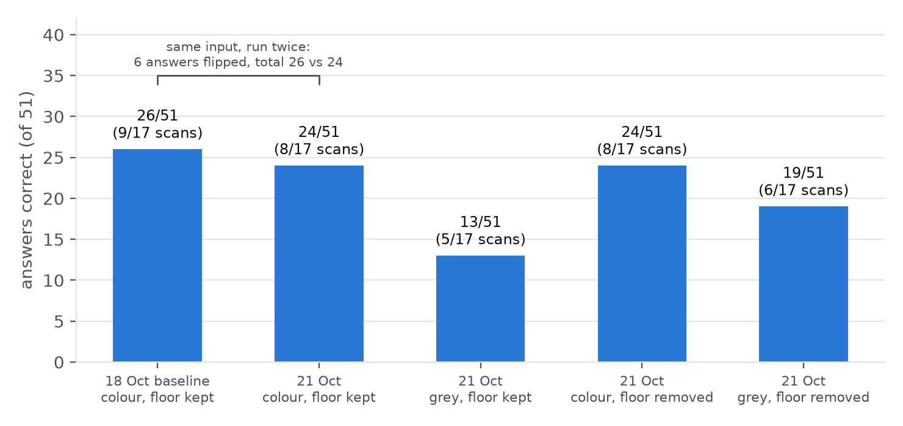
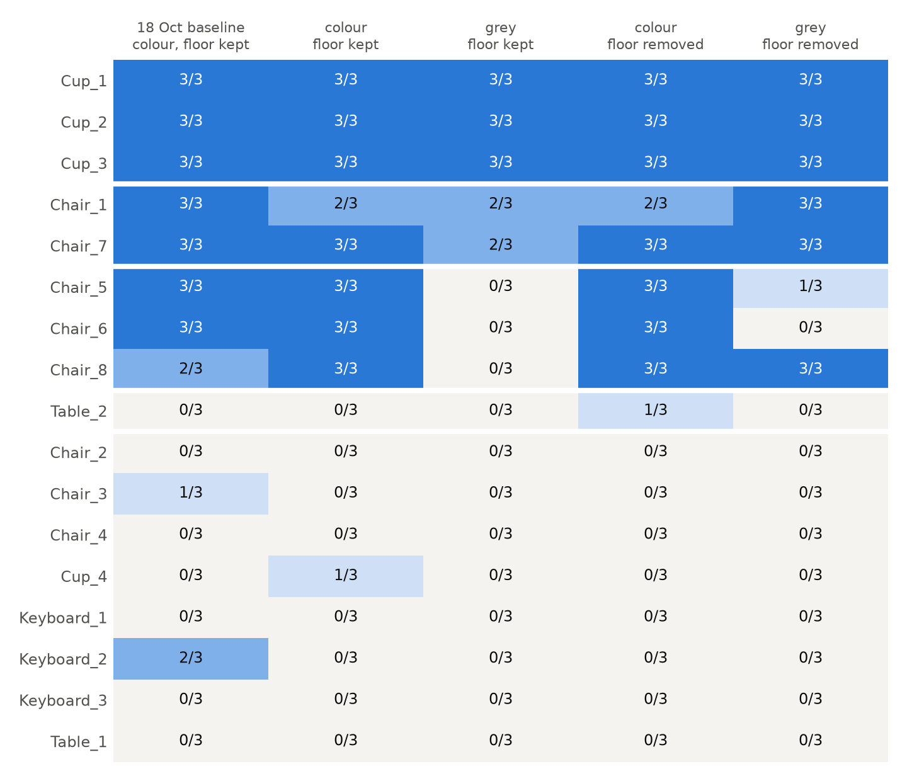

# Report: Does PointLLM need colour? Does removing the floor help?

| | |
|---|---|
| **Date** | 2026-10-21 |
| **Project** | localpoint3d: can 3D models trained on Western datasets recognise Bangladeshi objects? |
| **Team** | Shahedul Islam Shikder · Fahim Muntasir · Md Mosabbir |
| **Runs by** | Md Mosabbir (Colab, T4) |
| **Data** | the same 17 scans as the [18 Oct baseline](2026-10-18_pointllm_baseline.md) |
| **Results** | [`results/original_grey_floor_kept.csv`](../results/original_grey_floor_kept.csv), [`results/original_grey_floor_removed.csv`](../results/original_grey_floor_removed.csv) (102 rows each, scored in the `correct` column) |

---

## 1. Summary

We asked PointLLM-7B the same three questions about our 17 scans under four settings: **colour or grey**, and **floor kept or removed**. That makes 204 new answers. We compared them with each other and with the 18 Oct baseline.

1. **Colour matters.** Without colour, correct answers fell from **24 to 13 of 51** with the floor kept, and from **24 to 19** with it removed. Across both runs, removing colour turned 18 correct answers wrong and only 2 wrong answers right. The chairs that depend on colour are the red, blue and brown ones (Chair_5, 6, 8). Without colour they became "a wooden bar panel", "a cleared bush area" and "a white house".
2. **Removing the floor helps only when colour is gone.** With colour, it changed nothing (24 → 24). With grey scans it raised correct answers from **13 to 19**, and no answer got worse. Our reading: with colour, the model can tell the object from the floor. Without colour, object and floor merge into one grey shape, and removing the floor puts the object back on its own.
3. **Some scans fail in every setting.** Cups 1–3 were right in all 5 runs (45/45 answers). Eight scans were (almost) never right in any run: Chair_2, 3, 4, Cup_4, all three keyboards and Table_1. Removing the floor didn't save them. Most of them are the "too much scene" scans from the baseline report.
4. **⚠️ PointLLM is random inside, which we didn't know.** Its point encoder picks a random start point every time it reads a cloud. The same scan, with the same settings, gave the same text in only **3 of 51** answers between 18 Oct and 21 Oct. Whether the answer was correct changed for 6 of 51. So every difference below 6 flips per 51 answers could be chance. **Fixed for future runs:** the notebook now sets a random seed (`SEEDS_TO_TRY`).

**For the project:** PointLLM leans on colour, and on a clean separation from the floor, more than we assumed. Rickshaws and thelagaris are colourful, which may help PointLLM. But the classic ModelNet40 / ShapeNet classifiers we plan to test later get *no* colour at all (shape only). On our scans, the grey result above is the closer preview of how they may do.

---

## 2. What we ran

| Run | Colour | Floor | Answers | File |
|---|---|---|---|---|
| 18 Oct (baseline) | original | kept | 51 | `pointllm_2026-10-18_baseline.csv` |
| 21 Oct | original **and** grey | kept | 102 | `original_grey_floor_kept.csv` |
| 21 Oct | original **and** grey | **removed** | 102 | `original_grey_floor_removed.csv` |

- **Grey:** every point gets the same colour (0.5 grey). The positions are exactly the same as in the colour version, so only colour changes (`preprocess(..., colour="grey")`).
- **Floor removed:** the biggest horizontal plane in the bottom 30 % of the scan is deleted, together with every point within 1 cm of it (RANSAC, `src/cleanup.py`).
- **The same** for all runs: model `RunsenXu/PointLLM_7B_v1.2`, 8192 points, no rotation, greedy decoding, and the three paper prompts. I = "What is this?", C = "This is an object of ", Cap = "Caption this 3D model in detail."
- **Scoring rule, unchanged from the baseline:** an answer is correct if it names the right kind of object. "Mug" and "tumbler" count for cup. An answer that mentions the object only as part of a scene counts as *partly* and is added to the totals. A scan is correct when ≥ 2 of its 3 answers are. Claude scored all 204 answers by reading them; this hasn't been checked by a second person yet.

---

## 3. First, the noise: PointLLM isn't repeatable

The 18 Oct baseline and the 21 Oct "colour, floor kept" run had **identical input**: the same files, code path, points and prompts. We expected identical answers, because decoding is greedy. Instead:

- only **3 of 51** answers had the same text
- **6 of 51** answers flipped between correct and wrong (4 one way, 2 the other)
- **1 of 17** scan verdicts flipped (Keyboard_2: right on 18 Oct, wrong on 21 Oct)
- Chair_1 was "a black chair" on 18 Oct and **"a black wheelbarrow"** on 21 Oct, for the same prompt

**Cause.** PointLLM's point encoder (PointBERT) splits the cloud into local groups. It picks the group centres with farthest point sampling that starts from **`torch.randint`**, a random point ([`pointllm/model/pointbert/misc.py`](https://github.com/InternRobotics/PointLLM/blob/master/pointllm/model/pointbert/misc.py), function `fps`). Nothing sets the random seed. So on every call the model sees a slightly different grouping of the same shape. For borderline scans that is enough to change the answer.

**What it means for this report:** each answer is *one random draw*. Treat changes of a few answers as noise. The baseline's sentence "greedy, so the same input always gives the same answer" was wrong.

**Fix (done):** `ask()` now calls `torch.manual_seed(seed)` before every answer. The batch cell has `SEEDS_TO_TRY = [0]`. With one seed, results are repeatable. With `[0, 1, 2]`, each question is asked three times with different randomness, so we can see which answers are stable and take the majority. This is untested on the GPU so far.

---

## 4. Results overview

**Answers correct (of 51)**, 21 Oct runs:

| | floor kept | floor removed |
|---|---|---|
| **colour** | 24 (8/17 scans) | 24 (8/17 scans) |
| **grey** | 13 (5/17 scans) | 19 (6/17 scans) |

**By prompt** (answers correct of 17):

| Run | I | C | Cap |
|---|---|---|---|
| 18 Oct colour, floor kept | 9 | 7 | 10 |
| 21 Oct colour, floor kept | 7 | 8 | 9 |
| 21 Oct grey, floor kept | 5 | 3 | 5 |
| 21 Oct colour, floor removed | 8 | 8 | 8 |
| 21 Oct grey, floor removed | 6 | 7 | 6 |

**How the answers changed** between two settings, counting answers that went from correct to wrong ("lost") and from wrong to correct ("won"):

| Change | Lost | Won | Sign test p* | Scans lost / won |
|---|---|---|---|---|
| *Noise: same input, 18 Oct → 21 Oct* | *4* | *2* | *0.69* | *Keyboard_2 / none* |
| Colour → grey (floor kept) | **12** | 1 | 0.003 | Chair_5, 6, 8 / none |
| Colour → grey (floor removed) | 6 | 1 | 0.13 | Chair_5, 6 / none |
| Floor kept → removed (colour) | 2 | 2 | 1.0 | none / none |
| Floor kept → removed (grey) | 0 | **6** | 0.03 | none / Chair_8 |

\* *How likely a split this lopsided is by pure chance. It treats the 3 answers about one scan as independent, which they aren't, so read it as a rough guide.*

---

## 5. Colour

**Removing colour never helped a scan, and it hurt three chairs.**

| Scan | With colour (first sentence, unedited) | Grey (first sentence, unedited) |
|---|---|---|
| Chair_5 (red seat) | "a chair that features a vibrant red seat and backrest" | "a wooden bar panel, which is painted white" |
| Chair_6 (blue) | "a chair that features a vivid blue color" | "a rectangular, grey-coloured object that features a noticeable, centrally-located black hole"; "a cleared bush area" |
| Chair_8 (brown wood) | "a chair that is painted in a shade of grey" | "a simplistic, cartoon-style white house"; "a simplistic, rustic hut" |
| Table_2 | "a bar stool that has a cylindrical top" | "a circular object, resembling a washer" |
| Chair_2 | "a treadmill" (all 9 colour answers across both days) | "a rare, high-end personal computer"; "a building" |

- **Shape alone was enough** for Cup_1–3 (all 45 answers right across the 5 runs) and mostly for Chair_1 and Chair_7, which have distinctive frames (office chair, metal chair).
- **The colour-dependent chairs** all have one strong colour (red, blue, brown wood) on a plain shape. Without it, the model read the shape as a panel, a hut or a bush area.
- **Grey answers describe the object as "white".** "White" or "grey" appears in the first sentence of 25–30 of 51 grey answers, against 12–18 with colour. Typical: "in a pristine white color". The model turns grey input into "white".
- **Six answers were empty.** The model output only "This is an object of" and stopped. All six were **grey**, and all six were prompt **C** (sentence completion). With colour this never happened. Without colour, the completion prompt sometimes gets nothing at all.

---

## 6. Floor removal

- **With colour:** no effect. 24 → 24, with 2 answers lost and 2 won, which is the size of the noise.
- **With grey:** 13 → 19. Six answers improved and none got worse: Chair_8 3/3 (white house → white chair), plus one each for Chair_1, 5 and 7.
- **Scene answers** ("location", "beach", "ranch", "building"…) didn't consistently drop. With colour, 7 such answers with the floor and 10 without. With grey, 11 with the floor and 5 without.

**Interpretation.** In the baseline we guessed that the floor confuses the model. The data now says something more specific:
- When the object has its own colour, the model separates it from the floor anyway, so removing the floor adds nothing.
- When everything is the same grey, the floor and the object are one shape, and removing the floor helps.
- The scans that fail because of **other objects and walls** (Chair_2, 3, 4, Cup_4, Table_1) didn't improve, because removing one plane doesn't remove the rest of the scene. This agrees with the team's observation that automatic floor removal "is not that good" and the scans need manual cleaning.

---

## 7. Every scan

| Group | Scans | Pattern |
|---|---|---|
| Always right | Cup_1, Cup_2, Cup_3 | 3/3 in all 5 runs |
| Shape is enough | Chair_1, Chair_7 | right in every run, small noise |
| Needs colour | Chair_5, Chair_6, Chair_8 | 3/3 with colour, 0/3 when grey with the floor. Chair_8 recovers when the floor is removed |
| Near miss | Table_2 | always "bar stool" or "chair" (furniture, wrong class). Grey: "washer" |
| Never right | Chair_2, 3, 4, Cup_4, Keyboard_1–3, Table_1 | ≤ 1/3 in every 21 Oct run (Keyboard_2 had 2/3 once, on 18 Oct). Five of them are the scans ≥ 4× bigger than their object in the baseline report |

**Keyboards:** 0 correct in all four 21 Oct runs. The one keyboard success in the baseline (Keyboard_2) was a lucky draw, not a stable result.

---

## 8. What this means for the project

1. **Colour is a real cue for PointLLM.** For colourful local objects (painted rickshaws, CNGs) that may help. But we must report *with and without colour* to separate shape recognition from colour recognition.
2. **The classifiers planned next (PointNet++, DGCNN on ModelNet40) see shape only.** On our scans, the grey runs are the closer preview of how they may do.
3. **Scan cleaning matters more than the floor alone.** The scans that fail everywhere are cluttered scans. Manually cleaned versions (CloudCompare / Blender, saved under the same names in `Models_clean/`) are the next real test.
4. **Every future run needs a fixed seed, and ideally 3 seeds.** Otherwise we can't tell an effect from luck.

---

## 9. Limitations

- **One random draw per answer** (no seed yet). Effects of about ±6 answers per 51 could be noise.
- **17 scans**, and the 3 answers per scan aren't independent, so the p-values are rough.
- **One rater** (Claude, by reading), not checked by a teammate. Borderline calls: "tumbler" = cup ✓; "typewriter" ≠ keyboard; "bar counter … topped with a … table" = partly.
- Floor removal uses a single plane with a fixed 1 cm threshold. It wasn't tuned per scan.

---

## 10. Next steps

| # | Step | Why |
|---|---|---|
| 1 | Re-run "colour vs grey, floor kept" with `SEEDS_TO_TRY = [0, 1, 2]` | confirm the colour effect is larger than the noise, and test the seed fix on the GPU |
| 2 | Clean the 8 "never right" scans by hand, put them in `Models_clean/` with the same names, run again | separates "bad scan" from "model can't" |
| 3 | A teammate re-scores the `correct` columns | remove single-rater bias |
| 4 | Then the local objects, with colour and grey, 3 seeds | the actual research question |

---

## 11. How to reproduce

Notebook 01 on a T4: keep `ROTATION = "None"`, set `COLOURS_TO_TRY = ["original", "grey"]`, and set `FLOORS_TO_TRY = ["kept"]` for the first run and `["removed"]` for the second. Note: these two runs were made **before** the seed fix, so re-running gives different individual answers (see section 3).
