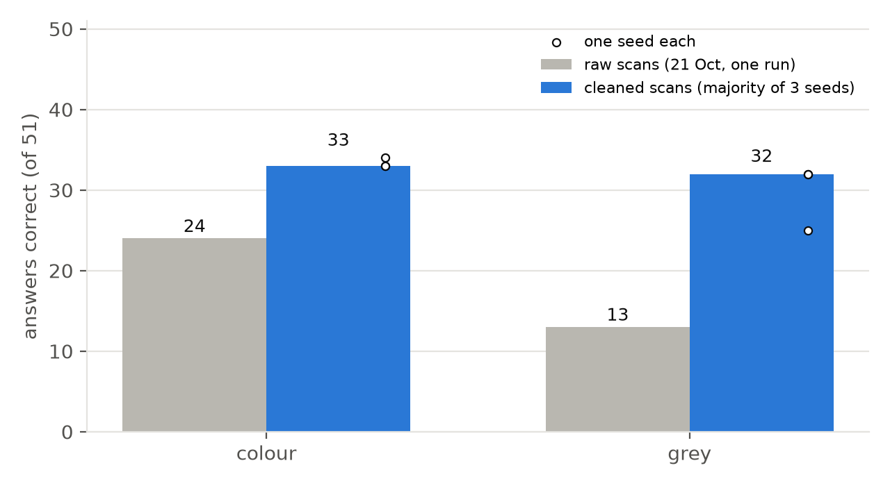
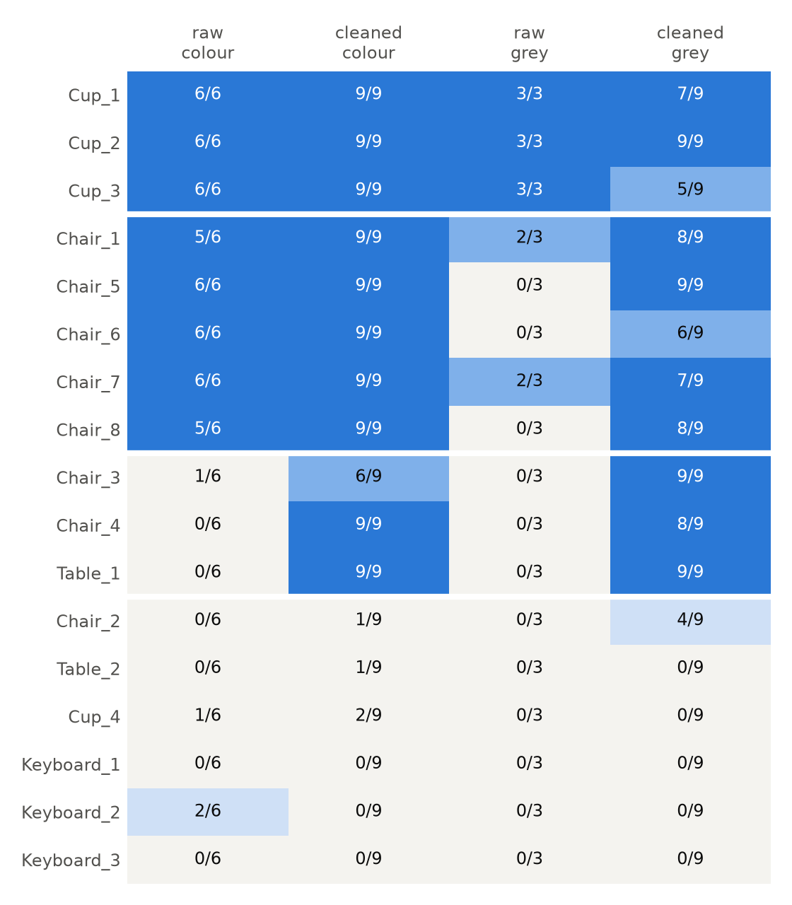

# Report: Hand-cleaned scans: PointLLM recognises most of them, with or without colour

| | |
|---|---|
| **Date** | 2026-10-23 |
| **Project** | localpoint3d: can 3D models trained on Western datasets recognise Bangladeshi objects? |
| **Team** | Shahedul Islam Shikder · Fahim Muntasir · Md Mosabbir |
| **Cleaning and run** | Md Mosabbir (CloudCompare cleaning; Colab T4 run) |
| **Data** | the same 17 objects as before, cleaned by hand (`Models_Cleaned/`, e.g. `Chair_04_cleaned.ply`) |
| **Results** | [`results/pointllm_cleaned_2026-10-23.csv`](../results/pointllm_cleaned_2026-10-23.csv): 306 answers, scored in the `correct` column |
| **Earlier runs** | [baseline, 18 Oct](2026-10-18_pointllm_baseline.md) · [colour and floor test, 21 Oct](2026-10-21_colour_and_floor_test.md) |

---

## 1. Summary

We deleted the floor, the walls and the other objects from all 17 scans by hand. The notebook also removed the leftover stray specks automatically. Then we asked PointLLM the three paper questions about each scan, in colour and in grey, each with 3 different random seeds.

1. **Cleaning is the biggest improvement so far.** Correct answers went from **24 → 33 of 51** in colour and **13 → 32 of 51** in grey. Scans recognised went from 8 → 11 and 5 → 10 of 17. Compared answer by answer with the raw 21 Oct run, cleaning fixed 9 answers and broke none in colour; in grey it fixed 21 and broke 2.
2. **Once the scans are clean, colour hardly matters** (33 vs 32 answers; 3 lost, 2 won). On 21 Oct, colour seemed essential. It turns out colour mostly helped the model tell the object apart from the clutter. With the clutter gone, shape alone is enough for chairs and tables.
3. **Three objects that failed in every earlier run are now recognised:** Chair_04 (0/6 → 9/9), Table_1 (0/6 → 9/9) and Chair_03 (1/6 → 6/9 in colour, 9/9 grey).
4. **Five scans still fail, and they fail in consistent ways:**
   - keyboards (0/9 each), seen as "carpet", "mattress", "panel"
   - Cup_4: "cupcake", "hat"
   - Table_2: "chair"
   - Chair_02: "treadmill" in colour; in grey it is right 4 of 9 times
5. **The 3 seeds disagreed more than the totals suggest.** Only 4 of 51 questions got word-for-word the same answer from all 3 seeds. Whether the answer was *correct* stayed the same for 48 of 51 questions in colour, but only 36 of 51 in grey. One grey seed scored 25 where the other two scored 32. Taking the majority over seeds matters, especially for grey.

**For the project:** with a clean scan, PointLLM recognises 11 of 17 everyday objects, and the 6 failures are either flat (keyboards) or look like a different familiar object. Before scanning rickshaws and thelagaris, the lesson is clear: **clean every scan the same way, then test.** A "not recognised" result now means much more than it did with raw scans.

---

## 2. What we ran

| | |
|---|---|
| Scans | 17 hand-cleaned point clouds (CloudCompare), same objects as the baseline |
| Automatic cleaning | `SPECKS = "removed"`: floating specks with < 1 % of the points are deleted before scaling. No automatic floor removal (`FLOOR = "kept"`), because the floor was already removed by hand |
| Model | `RunsenXu/PointLLM_7B_v1.2`, T4, float16, greedy decoding |
| Settings | no rotation; colour **and** grey; seeds **0, 1, 2**; the 3 paper prompts (I = "What is this?", C = "This is an object of ", Cap = "Caption this 3D model in detail.") |
| Answers | 17 × 3 prompts × 2 colours × 3 seeds = **306** |
| Scoring | same rule as before: correct if it names the right kind of object ("mug" = cup; "gaming chair" = chair; "cupcake" ≠ cup). A question counts as correct when ≥ 2 of its 3 seeds are correct, and a scan when ≥ 2 of its 3 questions are. Scored by Claude reading every answer; not yet checked by a teammate |

The raw scans were last run on 21 Oct **without** a fixed seed (one random draw per question). The cleaned numbers below are majorities over 3 seeds. That makes the cleaned numbers a bit more reliable, not inflated: the single seeds scored 33, 33 and 34 in colour.

---

## 3. Results



**Answers correct (of 51):**

| | raw (21 Oct, 1 run) | cleaned, seed 0 / 1 / 2 | cleaned, majority |
|---|---|---|---|
| colour | 24 | 33 / 33 / 34 | **33** |
| grey | 13 | 25 / 32 / 32 | **32** |

**Scans recognised (of 17), majority:**

| Object | Raw, colour | Cleaned, colour | Cleaned, grey |
|---|---|---|---|
| Chair (8) | 5 | **7** | **7** |
| Cup (4) | 3 | 3 | 2 |
| Table (2) | 0 | **1** | **1** |
| Keyboard (3) | 0 | 0 | 0 |
| **All (17)** | **8** | **11** | **10** |

**By prompt** (answers correct, averaged over the 3 seeds, of 17): colour I 11.0 · C 10.0 · Cap 12.3; grey I 10.3 · C 9.7 · Cap 9.7.

### Every scan



*Raw colour = 18 Oct + 21 Oct runs (6 answers). Raw grey = 21 Oct (3 answers). Cleaned = 3 prompts × 3 seeds (9 answers).*

| Group | Scans | What happened |
|---|---|---|
| Already worked, still work | Cups 1–3, Chairs 1, 5, 6, 7, 8 | 9/9 in colour. In grey the raw versions mostly failed (0/3 for Chairs 5, 6, 8); cleaned they mostly work (6–9 of 9) |
| **Fixed by cleaning** | Chair_03, Chair_04, Table_1 | raw: 0–1 correct out of 6 → cleaned: 6–9 of 9 |
| Still failing | Chair_02, Table_2, Cup_4, Keyboards 1–3 | see section 5 |

---

## 4. What cleaning changed: examples (first sentence, unedited)

| Scan | Raw (21 Oct) | Cleaned (23 Oct) |
|---|---|---|
| Chair_04 | "a toy airplane, predominantly white in color, with a distinct brown colored tail" | "a chair that features a unique design" |
| Table_1 | "a location featuring a ranch, painted in a monochrome white color scheme" | "a vibrant, animated table" (all 9 colour answers); grey: "a rectangular table, characterized by its clean, white color" |
| Chair_03 | "a simplistic, cartoon-style beach scene" | "a chair that is colored in a vibrant shade of blue" |
| Chair_05, grey | "a wooden bar panel, which is painted white" | "a chair that is rendered in a monochrome white color" |
| Chair_08, grey | "a simplistic, cartoon-style white house" | "a chair that is designed in a cartoon style" |

The raw scans were described as **scenes** ("ranch", "beach scene", "location"). The cleaned scans were described as **objects**. This confirms the "too much scene" explanation from the first two reports.

---

## 5. What still fails, and why we think so

| Scan | Typical answer (cleaned) | Likely reason |
|---|---|---|
| Keyboard_1, 2, 3 | "a rectangular mattress", "a cartoon-style carpet", "a rectangular panel … shaped like a window" | The shape is right (a flat rectangle) but the keys are a few mm tall: too small for the phone scan and for 8192 points. Keyboard_1 and 2 also still sit on a strip of desk. In 4 runs, 3 days and 2 cleaning levels, keyboards were recognised once, by luck. |
| Table_2 (small round side table) | "a chair that is predominantly white" (7 of 9 colour answers say "chair"); grey: "a glass", "a drum" | A small round table with short legs really is shaped like a stool. Consistent across every run. |
| Cup_4 | "a cartoon-like representation of a cupcake"; grey: "a white object that resembles a hat" | A short, wide cup with a saucer/base. 2 of 9 colour answers say "a cup of coffee". |
| Chair_02 (office chair) | "a treadmill … with a contrasting black seat" (8 of 9 colour answers) | The same wrong answer in **every** run (3 days, raw and cleaned). The model is confidently wrong, not confused. Interestingly, grey fixes it 4 of 9 times, so colour pushes it *towards* "treadmill" here. |

**Other observations**
- **"Flipped upside down":** 4 of 9 colour answers for Chair_08 say "a chair that has been flipped upside down", and 3 more say "broken" or "damaged". The chair is upright in our files (Z-up). This is a hint that PointLLM may expect a different "up" direction. The planned rotation test will answer that.
- **Empty answers:** 13 answers were just "This is an object of", all on prompt C. Ten were grey; three were in colour (Chair_03, all 3 seeds). Prompt C is the weakest prompt.

---

## 6. Colour, revisited

| | Answers correct, raw | Answers correct, cleaned |
|---|---|---|
| colour | 24 | 33 |
| grey | 13 | 32 |
| difference | **11** | **1** |

**On 21 Oct we wrote "colour matters".** That was true for raw scans, but cleaning shrank the gap from 11 answers to 1. Our updated explanation:
- With clutter, colour is how the model finds the object (the red chair stands out from the grey floor).
- Without clutter, the shape is visible on its own, and colour adds little.
- For the cups, grey still costs a bit (Cup_1 7/9, Cup_3 5/9). Their shape is simple, and colour and texture help there.

**What it means for the classic classifiers we plan later (shape only, no colour):** clean scans matter more than colour. That's good news for that test.

---

## 7. Limitations

- **One rater** (Claude). A teammate should check the `correct` column. Borderline calls: "gaming chair" = chair ✓; "cupcake" ≠ cup; "a chair that has been flipped upside down / broken" = chair ✓; "object of grey, metal, and mesh construction" (no object named) = ✗.
- **Raw vs cleaned isn't a perfectly matched comparison.** The raw runs had no seed (one random draw), and the cleaned run uses 3 seeds. The direction and size of the change (+9 colour, +19 grey, no losses in colour) are far larger than the ~6-answer noise we measured.
- **The seed fix isn't verified yet.** The 3 seeds gave different answers, so the seed is being applied. But we haven't asked the *same* seed twice to confirm it gives the *same* answer.
- **Different people may clean differently.** Cleaning was done by one person, by hand.
- 17 scans, 4 object types.

---

## 8. Next steps

| # | Step | Why |
|---|---|---|
| 1 | Rotation test on the cleaned scans: `ROTATIONS_TO_TRY = ["None", "-90 deg about X"]`, seeds [0, 1, 2], colour only | Find which way is "up" for PointLLM (hint: Chair_08 "flipped upside down") |
| 2 | Quick check: ask 2–3 questions twice with the same seed | Confirm the seed fix makes answers repeatable |
| 3 | A teammate re-scores `results/pointllm_cleaned_2026-10-23.csv` | Remove single-rater bias |
| 4 | Clean the local-object scans the same way (CloudCompare), named `<Object>_<take>_cleaned` | Then the real test: rickshaw, thelagari, … with the same settings |

---

## 9. How to reproduce

Notebook 01, Settings cell:

```python
SCANS_DIR = "/content/drive/MyDrive/Models_Cleaned"
RUN_NAME = "cleaned"
SPECKS = "removed"
ROTATIONS_TO_TRY = ["None"]
COLOURS_TO_TRY = ["original", "grey"]
FLOORS_TO_TRY = ["kept"]
SEEDS_TO_TRY = [0, 1, 2]
```

The run takes about 100 min on a T4.
