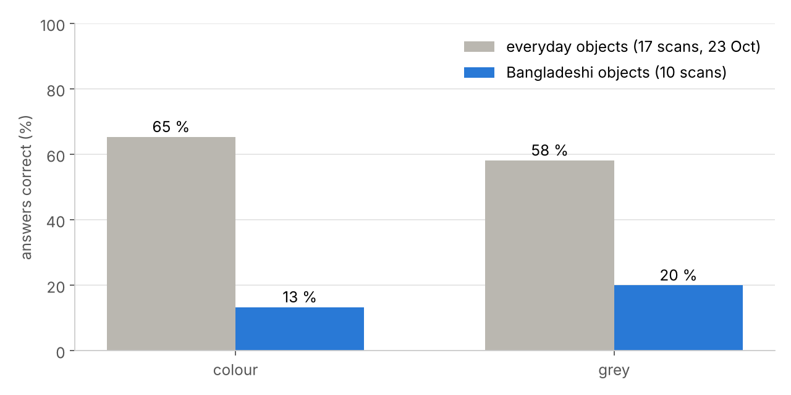
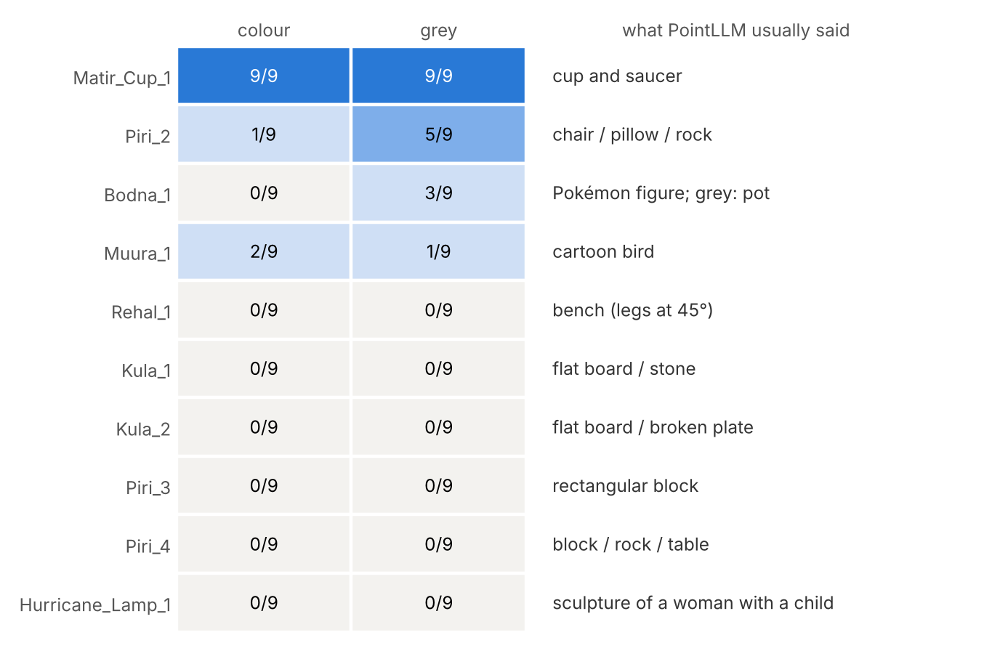

# Report: Bangladeshi objects: PointLLM sees the shape, but doesn't know the object

| | |
|---|---|
| **Date** | 2026-10-25 (report); run shortly before, results shared as `Bangla_stuff.xlsx` |
| **Project** | localpoint3d: can 3D models trained on Western datasets recognise Bangladeshi objects? |
| **Team** | Shahedul Islam Shikder · Fahim Muntasir · Md Mosabbir |
| **Data** | 10 hand-cleaned scans of 7 local objects (`*_cleaned.ply`): bodna, hurricane lamp, kula ×2, matir cup, muura, piri ×3, rehal |
| **Results** | [`results/pointllm_open_questions/pointllm_local_objects_2026-10-25.csv`](../results/pointllm_open_questions/pointllm_local_objects_2026-10-25.csv): 180 answers, scored in the `correct` column |
| **Earlier runs** | [hand-cleaned everyday objects, 23 Oct](2026-10-23_cleaned_scans.md) (same settings, the baseline to compare with) |

---

## 1. Summary

This is the first run on the real research question. We asked PointLLM about 10 hand-cleaned scans of everyday **Bangladeshi** objects, with exactly the settings that worked on chairs and cups on 23 Oct: the 3 paper prompts, colour and grey, 3 seeds each.

1. **PointLLM almost never recognises a Bangladeshi object.** It never used a local name (expected: these words aren't in its training data). Even with a lenient rule that accepts the nearest English equivalent (e.g. "pot" for bodna, "stool" or "chair" for muura), only **12 of 90** colour answers and **18 of 90** grey answers were right. For the cleaned everyday objects, the same settings gave **65 %** (colour) and **58 %** (grey) of answers correct. Here it was **13 %** and **20 %**.
2. **Only 1 of 10 scans is recognised in colour, and 2 of 10 in grey** (majority over seeds and prompts). Everyday objects: 11 of 17.
   - The **matir cup** works perfectly (18/18 "a cup and saucer"). It's the one object here that has a close Western twin.
   - **Piri_2** works in grey only, as "a chair" (5/9).
3. **The model often describes the shape correctly but names the wrong object.** This is the most useful finding:
   - **rehal** → "a rectangular **bench** … with two side legs positioned at angles of 45 degrees" (18/18 say bench). It sees the X-shaped folding legs, but it doesn't know a book stand.
   - **kula** → "a **flat**, oval-shaped board" (all 36 answers say flat). The shape is right, but it doesn't know a winnowing tray. 4 answers add "could be used as a tray".
   - **piri 3 and 4** → "a rectangular block", "a cuboid-shaped object". The shape is right; the use is unknown.
4. **When it doesn't know, it invents something familiar, and does so consistently:**
   - hurricane lamp → "a sculpture of a woman with a child seated on her lap" (15/18)
   - muura → "a cartoon-style figure that resembles a rare species of a bird" (10/18)
   - bodna → "a character from the Pokémon franchise" (7/18, in colour and grey)
5. **Grey did a bit better than colour** (18 vs 12 answers). Without colour, bodna became "a pot" / "a teapot" (3/9) and Piri_2 became "a chair" (5/9). For everyday objects, colour helped a little. Here the scanned colours seem to push the model towards "cartoon figure" answers. *Tentative: it's a small number of answers.*

**For the project:** this is the result the project was set up to find. A model trained on Western/Objaverse data recognises the one Bangladeshi object that has a Western twin (cup), but not the objects that are specific to Bangladesh. Its failures are **knowledge failures, not scan failures**: rehal, kula and piri are described with the right geometry. This makes a strong case for the next steps: fine-tuning on, or adding classes for, local objects.

---

## 2. What we ran

| | |
|---|---|
| Scans | 10 hand-cleaned point clouds of 7 objects (Drive folder `Ply`) |
| Automatic cleaning | `SPECKS = "removed"`; `FLOOR = "kept"` (floor already removed by hand) |
| Model | `RunsenXu/PointLLM_7B_v1.2`, T4, float16, greedy decoding |
| Settings | no rotation; colour **and** grey; seeds **0, 1, 2**; the 3 paper prompts (I = "What is this?", C = "This is an object of ", Cap = "Caption this 3D model in detail.") |
| Answers | 10 × 3 prompts × 2 colours × 3 seeds = **180** |

**The objects, and what we accepted as correct**

PointLLM can't know the Bangla names, so an answer counts as correct when its *main* object is the nearest English equivalent. "A flat board that could be used as a tray" counts as *board*, so it's wrong.

| Object | What it is | Accepted answers |
|---|---|---|
| Bodna (বদনা) | water pot with a spout, used for washing | pot, teapot, kettle, jug, ewer (not "cup") |
| Hurricane lamp (হারিকেন) | kerosene lantern with a glass chimney | lantern, lamp |
| Kula (কুলা) | flat woven bamboo winnowing tray | tray, basket, winnower (not "board") |
| Matir cup (মাটির কাপ) | small clay tea cup | cup |
| Muura (মোড়া) | cane/bamboo stool | stool, seat, chair |
| Piri (পিঁড়ি) | low wooden plank seat used on the floor | stool, seat, chair, bench (not "table") |
| Rehal (রেহাল) | X-shaped folding stand for holding the Quran | book stand, lectern (not "bench") |

Majority rule, as on 23 Oct: a question counts as correct when ≥ 2 of its 3 seeds are correct, and a scan when ≥ 2 of its 3 questions are. Scored by Claude reading every answer; not yet checked by a teammate.

---

## 3. Results



*Share of single answers correct. Everyday = the 17 hand-cleaned scans of 23 Oct, with the same settings.*

| | Everyday (23 Oct) | Bangladeshi (this run) |
|---|---|---|
| answers correct, colour | 100 / 153 (65 %) | **12 / 90 (13 %)** |
| answers correct, grey | 89 / 153 (58 %) | **18 / 90 (20 %)** |
| questions correct (majority), colour | 33 / 51 | **3 / 30** |
| questions correct (majority), grey | 32 / 51 | **6 / 30** |
| scans recognised, colour | 11 / 17 | **1 / 10** |
| scans recognised, grey | 10 / 17 | **2 / 10** |

Single seeds: colour 3 / 5 / 4, grey 7 / 7 / 4 answers correct (of 30). **By prompt** (averaged over seeds, of 10): colour I 1.3 · C 1.0 · Cap 1.7; grey I 1.7 · C 2.7 · Cap 1.7.

### Every scan



---

## 4. What it said: examples (first sentence, unedited)

| Scan | Answer |
|---|---|
| Matir_Cup_1 (all 18) | "a matching set of a grey cup and saucer. The cup is round with a handle on the side" |
| Rehal_1 | "a rectangular bench … with two side legs positioned at angles of 45 degrees" |
| Kula_1 | "a flat, circular board that resembles a shallow boat … could be used … as a tray for small items" |
| Kula_2 | "flat, broken ceramic pieces … a ceramic plate or dish that has been accidentally broken" (all 6 prompt-C answers) |
| Piri_2, grey | "a minimalist representation of a chair, featuring a flat, rectangular design … does not have … a backrest" |
| Piri_3 | "a rectangular block with a light gray color … its form is simplistic with no distinct features" |
| Piri_4 | "a rectangular, grey-coloured block that has been subjected to a series of cuts"; also "a rectangular table" (2/18) |
| Bodna_1, colour | "a cartoon-like figure designed to resemble a character from the Pokémon franchise … shaped like a Poké Ball" |
| Bodna_1, grey | "a pot with a lid … possibly made of clay or metal"; "a traditional teapot" |
| Muura_1 | "a cartoon-style figure that resembles a rare species of a bird"; once "a unique, one-of-a-kind stool" |
| Hurricane_Lamp_1 | "a grey, abstract sculpture depicting a woman with a child seated on her lap" |

---

## 5. Three kinds of failure

| Kind | Scans | What happens | What it tells us |
|---|---|---|---|
| **Right shape, unknown object** | Rehal, Kula ×2, Piri_3, Piri_4 | geometry described correctly (bench with 45° legs, flat oval board, rectangular block); named as the nearest Western object or not named at all | the encoder sees the shape; the *concept* is missing. This is what fine-tuning on local objects should fix |
| **Familiar-looking but wrong** | Hurricane lamp, Muura, Bodna (colour) | a confident, repeated wrong answer (sculpture, bird, Pokémon) | the shape doesn't match any training object, so the model falls back on "cartoon figure / sculpture". 49 of 180 answers say "cartoon" |
| **Partly works** | Piri_2 (grey), Bodna (grey), Muura (3/18) | the right *kind* of object in some seeds | close to a Western category (seat, pot), but not close enough to be stable |

**Other observations**
- **Matir cup "with a handle" and "saucer":** all 18 answers say both. If our clay cup has no handle or saucer (check the scan), the model is describing a typical Western cup, not ours. It's still correct, but the right label may come from a prior, not from the shape.
- **Colour and grey gave word-for-word the same answer 19 times** (out of 90 pairs), mostly the matir cup (8/9). On 23 Oct, that happened 0 of 153 times. These scans may have very muted colours, so grey changes little. We can't check this here, because the scans aren't in the repo. Look at the preview cell.
- **Hallucinated colour:** Kula_2 in **grey** is described as "concentric circles in varying shades of white, dark blue, light blue, and yellow". That's the same sentence as in colour (seed 0), so this answer ignores the colour input entirely.
- **Empty answers:** 6, all Piri_3 prompt C ("This is an object of" and nothing else), in both colour and grey, all seeds. Same weakness of prompt C as on 23 Oct.
- **Seeds:** the correct/wrong verdict was the same for all 3 seeds in 27 of 30 questions in colour and 26 of 30 in grey. Most answers are consistently wrong, not randomly wrong.

---

## 6. Limitations

- **One rater** (Claude), with a lenient "nearest English word" rule we made up for this run. Borderline calls:
  - "chair" for muura and piri = ✓ (seat furniture), but "table" for piri = ✗
  - "cup of tea" for bodna = ✗
  - "board … could be used as a tray" for kula = ✗ (main object is a board)
  - A stricter rule (only stool/seat for muura and piri) would drop 7 correct answers: 2 for muura, 5 for piri. A teammate should check the `correct` column.
- **Small set:** 10 scans, 7 objects, mostly 1 take each. Piri has 3 takes, and they behave very differently (5/9 vs 0/9 in grey), so take-to-take variation is large.
- **Objects differ from everyday ones in more than "being Bangladeshi":** a kula is flat like the keyboards (which also failed), and a hurricane lamp has thin wire and glass parts that phone scans capture badly. Some failures may be partly scan quality. The rehal/kula/piri shape descriptions suggest the scans themselves are fine.
- No rotation test yet: the scans are Z-up as exported.

---

## 7. Next steps

| # | Step | Why |
|---|---|---|
| 1 | A teammate re-scores `results/pointllm_open_questions/pointllm_local_objects_2026-10-25.csv`, and agrees on the "accepted answers" table | The scoring rule for local objects is new and matters a lot here |
| 2 | Look at the previews of Matir_Cup_1, Hurricane_Lamp_1 and Kula_2 in notebook 01 (colour vs grey) | Check colour quality, and whether the cup has a handle/saucer |
| 3 | Ask targeted questions in the chat cell: "Is this a lantern?", "What is this used for?" | Does the model know the object when given the name? (closed vs open question) |
| 4 | Rotation test (`ROTATIONS_TO_TRY = ["None", "-90 deg about X"]`) on these 10 scans | Rule out "upside down" as a cause before blaming knowledge |
| 5 | Scan the larger planned objects (rickshaw, thelagari, CNG) the same way | Vehicles have closer Western twins (cart, tricycle, car) |
| 6 | Same scans through ModelNet40 classifiers (PointNet++/DGCNN) | Closed-set view: which of the 40 classes does a kula fall into? |

---

## 8. How to reproduce

Notebook 01, Settings cell:

```python
SCANS_DIR = "/content/drive/MyDrive/Ply"     # the folder with the local *_cleaned.ply scans (the CSV says "Ply")
SPECKS = "removed"
ROTATIONS_TO_TRY = ["None"]
COLOURS_TO_TRY = ["original", "grey"]
FLOORS_TO_TRY = ["kept"]
SEEDS_TO_TRY = [0, 1, 2]
```

The run takes about 60 min on a T4 (10 scans × 18 questions).
