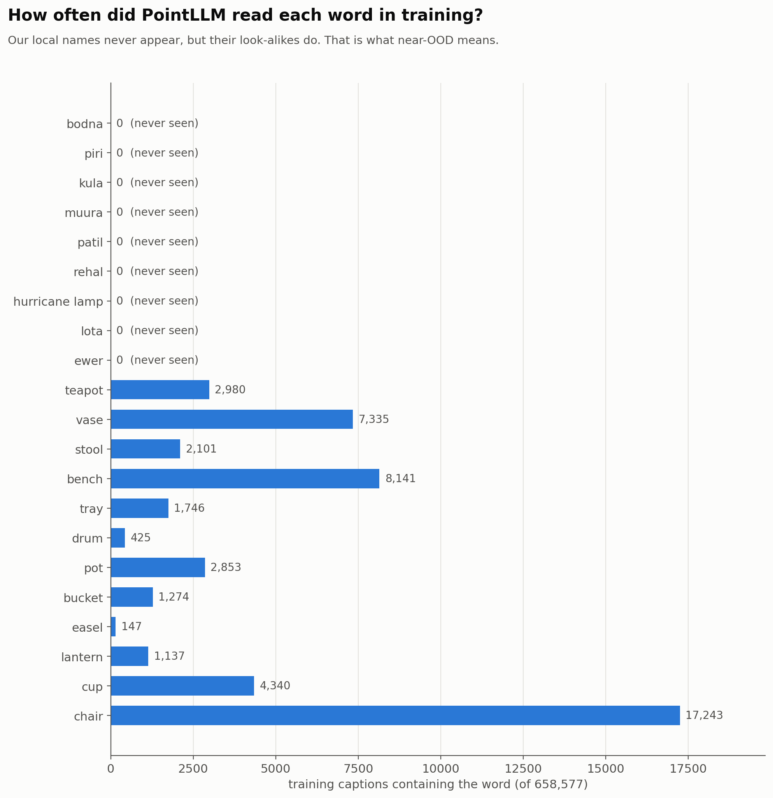
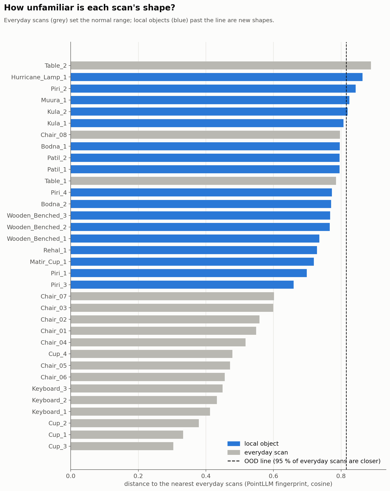
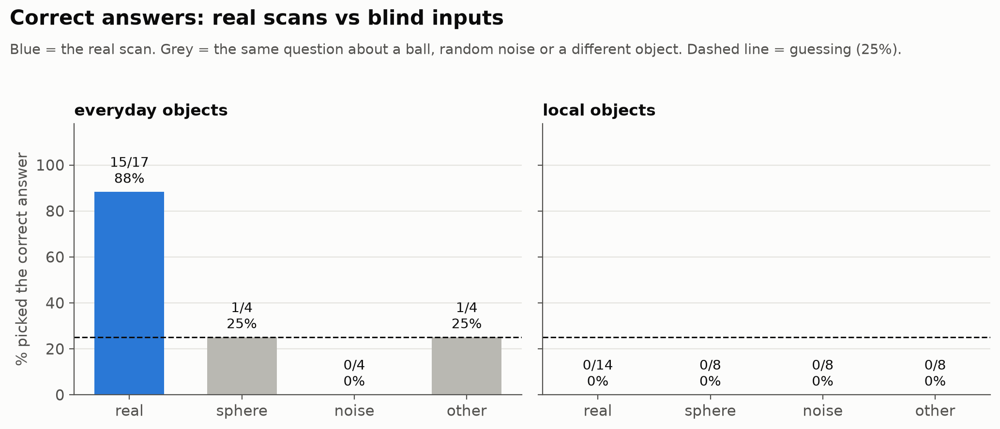
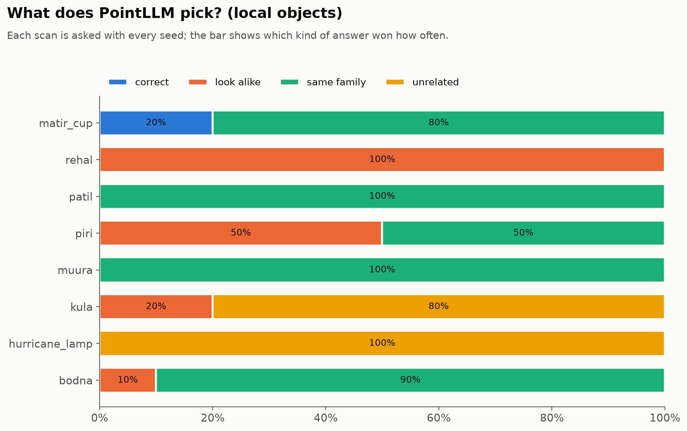
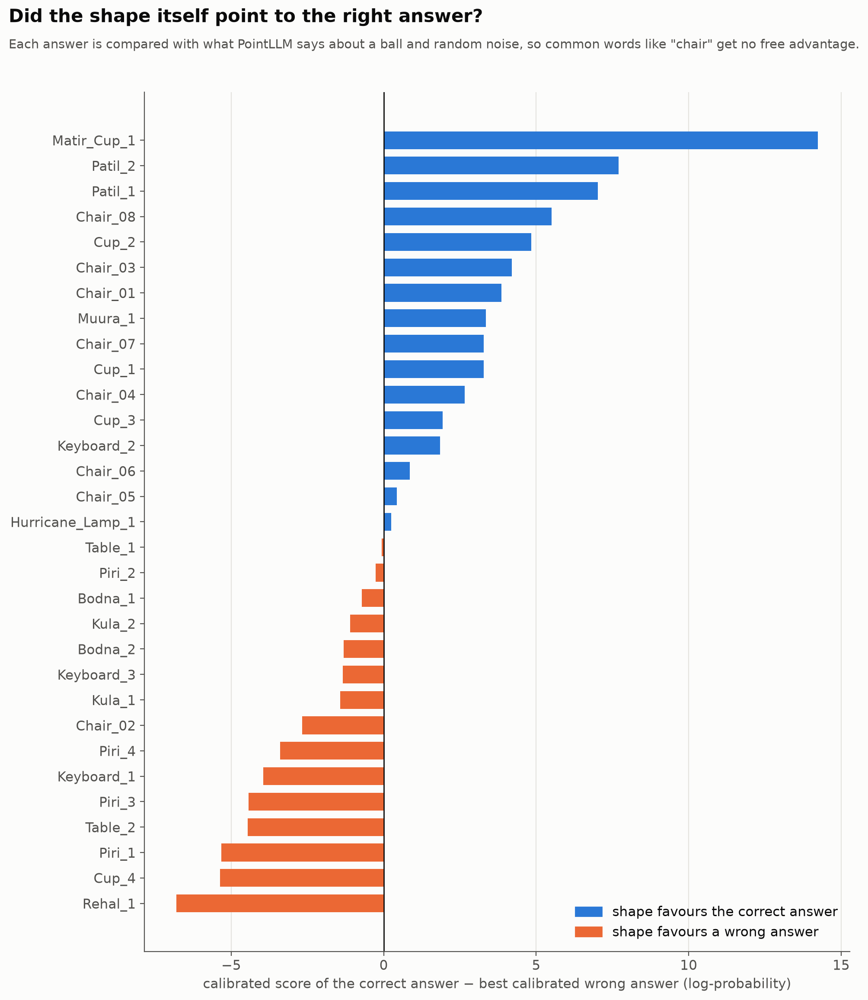

# Report: Local objects as near-OOD: PointLLM reads the shape, then picks the nearest familiar object

| | |
|---|---|
| **Date** | 2026-11-01 (run 2026-10-31) |
| **Project** | localpoint3d: can 3D models trained on Western datasets recognise Bangladeshi objects? |
| **Team** | Shahedul Islam Shikder · Fahim Muntasir · Md Mosabbir |
| **Notebook** | [`03_pointllm_mcq_near_ood.ipynb`](../notebooks/03_pointllm_mcq_near_ood.ipynb) |
| **Data** | 14 cleaned scans of 8 local objects + the 17 cleaned everyday scans, **grey** (no colour). Wooden_Benched ×3 is in the OOD check only (no answer options yet) |
| **Results** | [raw scores](../results/pointllm_mcq_near_ood_2026-10-31.csv) (1,340 rows) · [summary](../results/pointllm_mcq_near_ood_2026-10-31_summary.csv) · [per scan](../results/pointllm_mcq_near_ood_2026-10-31_per_scan.csv) · [calibrated](../results/pointllm_mcq_near_ood_2026-10-31_calibrated.csv) · [OOD distances](../results/pointllm_mcq_near_ood_2026-10-31_ood.csv) · [training words](../results/pointllm_mcq_near_ood_2026-10-31_training_words.csv) |
| **Re-run** | same scans with short options (1–2 words): [raw](../results/pointllm_mcq_near_ood_short_options_2026-10-31.csv) · [summary](../results/pointllm_mcq_near_ood_short_options_2026-10-31_summary.csv) · [calibrated](../results/pointllm_mcq_near_ood_short_options_2026-10-31_calibrated.csv), see §7 |
| **Earlier runs** | [local objects, open answers, 25 Oct](2026-10-25_local_objects.md) · [everyday cleaned scans, 23 Oct](2026-10-23_cleaned_scans.md) |

---

## 1. Summary

The 25 Oct open-ended run showed PointLLM almost never names a Bangladeshi object. This run asks *why*: can it not see the shape, or does it see the shape and have no name for it? We gave it **multiple choice in grey** (shape only) and compared its choice with what it says about a featureless ball and random noise.

1. **Our local objects are near-OOD.**
   - PointLLM's 658,577 training captions **never** contain bodna, piri, kula, muura, patil, rehal, lota or ewer. Their look-alikes are common (bench 8,141, vase 7,335, teapot 2,980).
   - PointLLM's own shape fingerprints agree: local scans sit 0.66–0.86 from the everyday scans. Everyday scans are mostly 0.30–0.60 from each other; Chair_08 (0.80) and the two tables are the exceptions.
2. **For known objects the multiple choice works, and it comes from the shape.**
   - Everyday scans: **15 of 17** correct (p < 0.001 vs 25 % guessing).
   - The same questions about a ball or noise: **1 of 8**.
3. **For local objects it never picks the correct answer: 0 of 14.** It picks the nearest *familiar* object instead:
   - patil and matir cup → bowl
   - bodna → vase
   - muura → chair
   - rehal → bench (as in the 25 Oct open answers, 18/18)
   - piri → bench or box
4. **It still reads the shape.** The ball and noise get different picks than the real scans. Once we subtract what PointLLM says about "nothing" (calibrated score), the correct answer wins for **5 of 14** local scans: matir cup, both patils and muura clearly, and hurricane lamp by a hair. Bodna and kula lose narrowly to their look-alike (teapot, cutting board).

5. **A re-run with short, fair options (e.g. "water jug" instead of "spouted water pot") gives the same answer: 0 of 14** (§7). The picks didn't change at all; only the shape-based (calibrated) wins dropped from 5 to 3. The scores are also exactly reproducible: the same scan with the same seed gave the identical score in both runs.

**For the project:** this is the near-OOD pattern we expected. The model *sees* a bench-like rehal and a bowl-like patil, but it can only answer with categories from Objaverse. The failure is missing knowledge, not a bad scan or a blind model. That supports the next step: adding local classes, or fine-tuning.

---

## 2. What we ran

| | |
|---|---|
| Model | `RunsenXu/PointLLM_7B_v1.2`, T4, float16 |
| Input | hand-cleaned scans, **grey** (rgb = 0.5), specks removed, 8192 points |
| Question | "What is this?" (one of PointLLM's training questions) |
| Options | 4 per object, chance = 25 %: **correct** (plain English), **look-alike** (often the mistake from 25 Oct), **same family**, **unrelated**. Answers are scored as "A teapot." |
| How it "answers" | it doesn't write anything: we measure how likely PointLLM finds each answer (log-likelihood) and take the most likely. 5 seeds, majority vote |
| Blind inputs | the same 4 options for a **ball**, **random noise** and **a scan of a different object** |
| OOD check | (a) word counts in PointLLM's training captions; (b) distance of PointLLM's shape fingerprint (mean of its 513 point tokens) to the 3 nearest everyday scans |

Options used in this run:

| Object | correct | look-alike | same family | unrelated |
|---|---|---|---|---|
| bodna | spouted water pot | teapot | vase | chair |
| piri | low wooden stool | box | bench | cup |
| kula | woven bamboo tray | cutting board | basket | chair |
| muura | low cane stool | drum | chair | teapot |
| patil | metal cooking pot | bucket | bowl | chair |
| rehal | folding book stand | bench | bookshelf | cup |
| matir cup | clay cup | flower pot | bowl | chair |
| hurricane lamp | kerosene lantern | glass jar | candle | chair |
| *everyday* | chair / cup / table / keyboard | stool / vase / bench / tray | … | … |

---

## 3. Are our objects out-of-distribution?

None of the local names appear in training. "Hurricane lamp" doesn't either, though "lantern" does (1,137 captions).

- **Everyday scans** (grey): mostly 0.30–0.60 from their nearest everyday neighbours. Chairs have other chairs and cups have other cups.
- **Local scans** (blue): **0.66–0.86**, farther than every cup and keyboard and all chairs except Chair_08 (0.80). 4 are past the strict OOD line: Hurricane_Lamp, Piri_2, Muura and Kula_2.
- **Caveat:** the 2 tables are just as far (Table_2 is even past the line), because there are only 2 tables and they differ. 17 scans of 4 kinds make a small reference. ModelNet40 would be a bigger one.
- **The nearest neighbours make sense:** bodna and matir cup → a cup; most others → a table or keyboard (flat, boxy). Matir cup is the closest local object, and also the best recognised below.

---

## 4. Multiple choice: which answer is most likely?

| | Real scans | Ball | Noise | Other object |
|---|---|---|---|---|
| Everyday (17 scans, 4 objects) | **15 / 17** (p < 0.001) | 1 / 4 | 0 / 4 | 1 / 4 |
| Local (14 scans, 8 objects) | **0 / 14** | 0 / 8 | 0 / 8 | 0 / 8 |

| Object | PointLLM picks | Matches 25 Oct open answers? |
|---|---|---|
| rehal | **bench** (5/5 seeds) | yes: "a bench" 18/18 |
| patil | **bowl** (both scans) | – |
| matir cup | **bowl** (80 %); "clay cup" 20 % | close: 25 Oct said "cup and saucer" |
| bodna | **vase** (90 %), teapot 10 % | yes: grey answers said "pot" / "teapot" |
| muura | **chair** | – |
| piri | **bench** (Piri 1–2), **box** (Piri 3–4) | yes: "a rectangular block" |
| kula | **chair** (80 %), cutting board 20 % | partly: "a flat, oval-shaped board" |
| hurricane lamp | **chair** | – |

"Chair" is the most common word in training (17,243 captions). It wins when nothing fits well: kula, hurricane lamp, muura.

**Stability:** all 5 seeds agreed for 24 of 31 scans. Scoring likelihoods is much steadier than generating text, where 3 seeds rarely agreed word for word.

---

## 5. Calibrated: did the shape push toward the right answer?

Common words like "chair" have an advantage even with no object at all. To remove it, each answer's likelihood for the real scan is compared with its likelihood for "nothing" (the average of ball and noise):

| | correct answer has the biggest calibrated score |
|---|---|
| Everyday | 11 / 17 |
| Local | **5 / 14**: matir cup (+14.2), patil ×2 (+7.0, +7.7), muura (+3.3), hurricane lamp (+0.2, a tie) |

- **Narrowly lost:** bodna (to teapot, −0.7 / −1.3) and kula (to cutting board, −1.1 / −1.4).
- **Clearly lost:** piri (to bench, all 4 scans) and rehal (to bench, −6.8).

**Reading:** for patil, matir cup and muura, the shape does favour the right description. The plain vote just goes to a more common word ("bowl", "chair"). For rehal and piri, the shape itself says "bench". That's an honest shape match: a rehal opened flat and a piri really are bench-like.

This view is only supporting evidence. It is also harsher on everyday scans (11 vs 15 of 17), so the ball/noise baseline isn't perfectly neutral.

---

## 6. A mistake we caught (and fixed)

The notebook first compared answers by likelihood **per letter**. With our options that favoured the **longest** answer: for ball and noise it picked the longest option 71 % of the time. Because the local "correct" answers were long ("spouted water pot") and the wrong ones short ("vase"), the first summary claimed **11 of 14 local scans correct**, and random noise got 7 of 8.

That number is wrong. Everything in this report uses the plain likelihood, re-computed from the saved raw scores with [`reports/build/mcq_reanalyse.py`](build/mcq_reanalyse.py). The flawed tables are kept in `reports/results/flawed_per_char_scoring/` for the record.

Fixes now in the notebook:
- Plain likelihood is the default.
- The calibrated score is shown as a second view.
- A warning appears when options differ in length by 2+ words.
- New options of 1–2 words each (§8).

---

## 7. Re-run with short options

Same scans, same settings. Only the "correct" answers were shortened to 1–2 words so they compete fairly:

| Object | Run 1 (long) | Run 2 (short) |
|---|---|---|
| bodna | spouted water pot | water jug |
| piri | low wooden stool | low stool |
| kula | woven bamboo tray | bamboo tray |
| muura | low cane stool | cane stool |
| patil | metal cooking pot | cooking pot |
| rehal | folding book stand | book stand |
| hurricane lamp | kerosene lantern | lantern |

*(Colab still ran an older copy of the notebook, so its own summary used the flawed per-letter score. Everything below is re-scored from the raw CSV.)*

| | Run 1 (long options) | Run 2 (short options) |
|---|---|---|
| Everyday, plain likelihood | 15 / 17 | 15 / 17 (identical scores) |
| **Local, plain likelihood** | **0 / 14** | **0 / 14** |
| Local, calibrated (vs ball and noise) | 5 / 14 | 3 / 14 |

- **The picks are the same as in run 1:** patil and matir cup → bowl, bodna → vase, muura/kula/hurricane lamp → chair, piri → bench/box, rehal → bench. Shorter correct answers didn't win a single scan.
- **Where the correct answer came closest** (average log-probability; closer to 0 = more likely):

  | Object | Pick | Correct answer |
  |---|---|---|
  | matir cup | bowl −21.6 | clay cup −21.9 (a tie) |
  | hurricane lamp | chair −24.3 | lantern −25.9 (2nd) |
  | patil | bowl −17.0 | cooking pot −23.3 (2nd) |

  For bodna, kula, muura and piri the correct answer came **last**.
- **Calibrated:** the shape favours the correct answer for matir cup (+14.2), Patil_2 (+2.2) and Piri_2 (+0.2, a tie).
  - Elsewhere the shape points to a look-alike: **bodna → teapot** (−7 to −10), **rehal → bench** (−7.3), **kula → cutting board**, piri → bench.
  - Muura's "cane stool" now loses to chair (it won as "low cane stool" in run 1). So the calibrated view is sensitive to wording, and the plain result is the robust one.
- **Reproducible:** the everyday options didn't change, and their 340 scores are identical to run 1 to the last decimal. The seed fix works.

**Conclusion:** the near-OOD result doesn't depend on how we phrased the correct answer. PointLLM maps each Bangladeshi object to the closest familiar Objaverse category.

---

## 8. Limitations

- **Small:** 14 local scans of 8 objects (1–4 scans each). Per-object results rest on 1–2 scans.
- **The options shape the result.** Shortening the correct answers didn't change the picks (§7), but the calibrated view moved (5 → 3 of 14). Other wordings could still matter.
- **Only one question wording** ("What is this?") and one grey value (0.5). The PointLLM paper fed colourless objects as black, which we haven't tried yet.
- **Small OOD reference:** 17 everyday scans of 4 kinds.

---

## 9. Next steps

| # | Step | Why |
|---|---|---|
| 1 | ~~Re-run with short options~~ | Done (§7): 0/14 holds |

Options used in the re-run:

| Object | correct | look-alike | same family | unrelated |
|---|---|---|---|---|
| bodna | water jug | teapot | vase | chair |
| piri | low stool | box | bench | cup |
| kula | bamboo tray | cutting board | basket | chair |
| muura | cane stool | drum | chair | teapot |
| patil | cooking pot | bucket | bowl | chair |
| rehal | book stand | bench | bookshelf | cup |
| matir cup | clay cup | flower pot | bowl | chair |
| hurricane lamp | lantern | glass jar | candle | chair |

| # | Step | Why |
|---|---|---|
| 2 | The same test with **CLIP (OpenShape)**, notebook 04, same options file | Does a CLIP-style model make the same near-OOD mistakes? |
| 3 | Add answer options for the wooden bench | It's in the OOD check but not the multiple choice yet |
| 4 | Optional: `COLOUR = "black"` once | PointLLM's paper used black for colourless objects |
