# LocalPoint3D · Far-OOD test

Run far_ood_2026-11-07_1947 · PointLLM 7B v1.2 · grey · seeds [0, 1, 2] · 42 scans

## 1. Summary

- Scans: **everyday** 20, **near_ood** 14, **far_ood** 8.
- Median fingerprint distance to the everyday scans: everyday 0.45, near_ood 0.77, far_ood 0.63. **Not** in the expected order.
- Multiple choice (own 4 options, 25 % by guessing), real scans correct: everyday 18/20, near_ood 0/14, far_ood 0/8.
- All-labels test (~1 in 39 by guessing), calibrated top-1 / top-3: everyday 5/20 / 12/20, near_ood 1/14 / 5/14, far_ood 0/8 / 0/8.
- How sure PointLLM is about its best label (median share): everyday 0.84, near_ood 0.53, far_ood 0.37.
- Far-OOD objects were called: rickshaw -> bench; sheel_pata -> faucet; thela_gari -> bench; thela_gari -> low stool; thela_gari -> bench; thela_gari -> low stool; thela_gari -> bench; tubewell -> bench.

## 2. What we ran

| group | scans | objects |
|---|---|---|
| everyday | 20 | chair, cup, keyboard, table, wooden_benched |
| near_ood | 14 | bodna, hurricane_lamp, kula, matir_cup, muura, patil, piri, rehal |
| far_ood | 8 | rickshaw, sheel_pata, thela_gari, tubewell |

Model RunsenXu/PointLLM_7B_v1.2 (T4, float16). Input: 8192 points, grey, specks removed. Question: "What is this?". Answers are scored by likelihood, not generated. Multiple-choice seeds [0, 1, 2]; all-labels seeds [0]; blind inputs ['sphere', 'noise']. Options: data/mcq_options.csv.

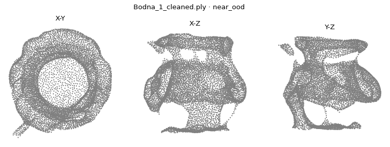

*bodna (near_ood): what the model sees*

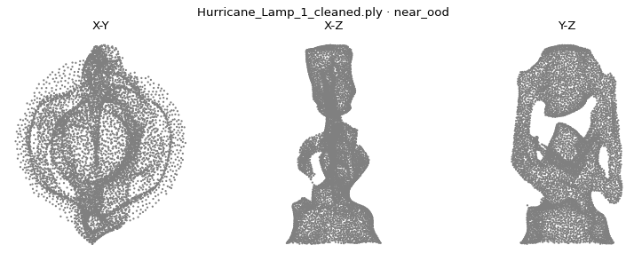

*hurricane_lamp (near_ood): what the model sees*

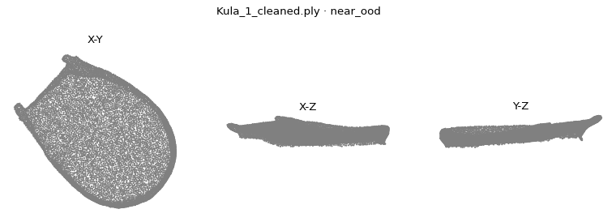

*kula (near_ood): what the model sees*

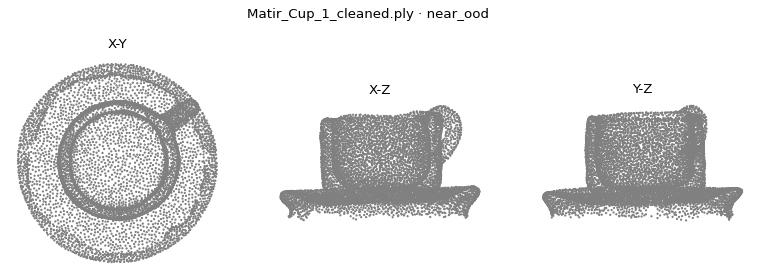

*matir_cup (near_ood): what the model sees*

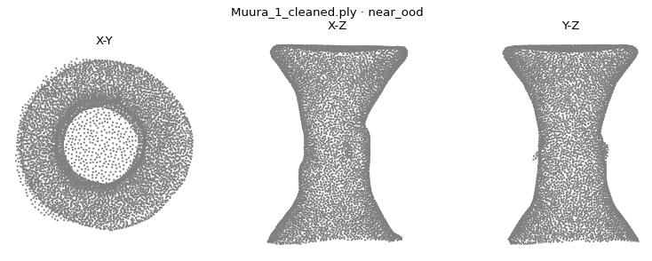

*muura (near_ood): what the model sees*

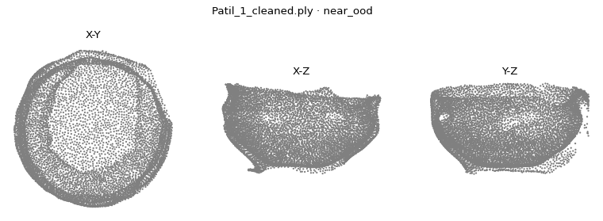

*patil (near_ood): what the model sees*

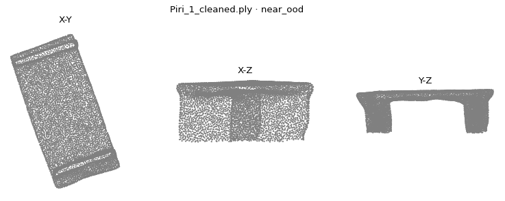

*piri (near_ood): what the model sees*

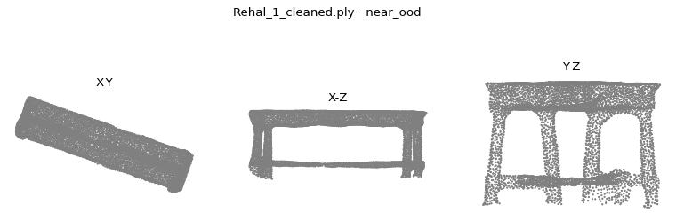

*rehal (near_ood): what the model sees*

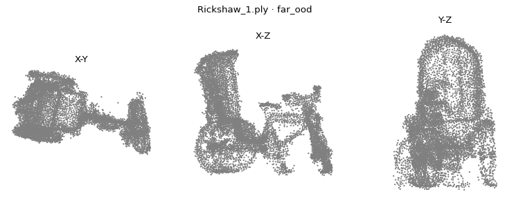

*rickshaw (far_ood): what the model sees*

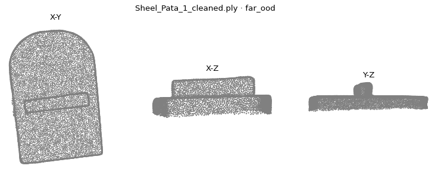

*sheel_pata (far_ood): what the model sees*

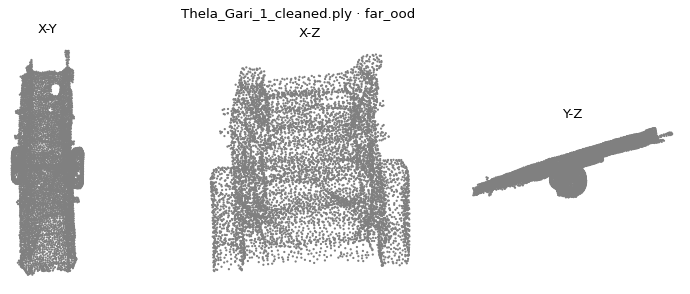

*thela_gari (far_ood): what the model sees*

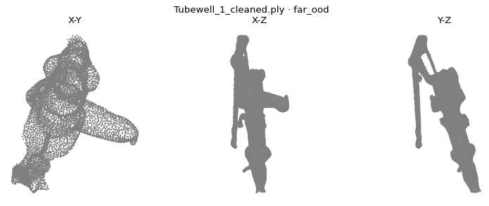

*tubewell (far_ood): what the model sees*

## 3. Are the groups really different? (OOD check)

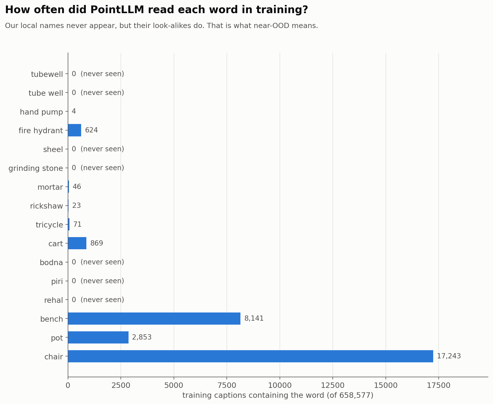

*Training captions containing each word (of 658,577).*

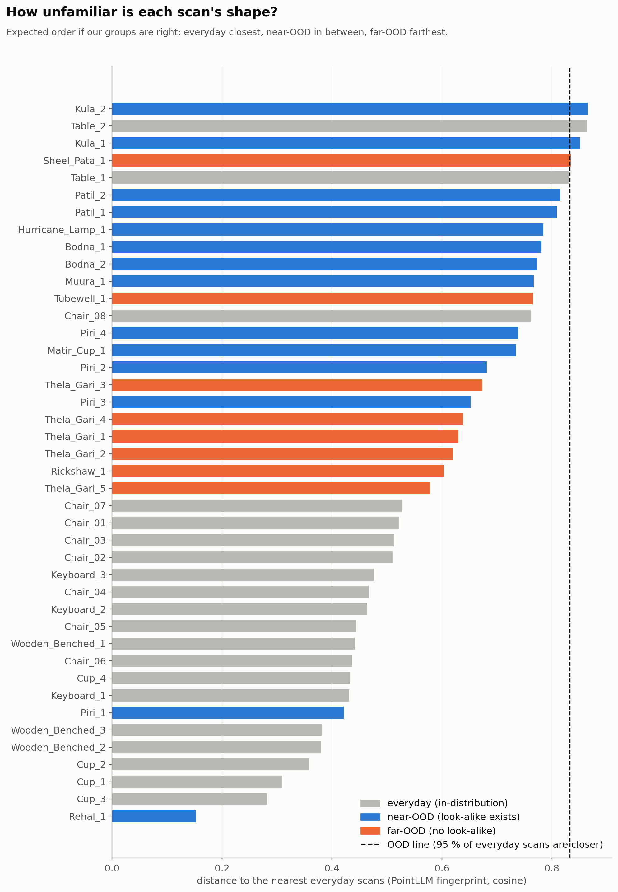

*Distance to the 3 nearest everyday scans. OOD line = 0.833.*

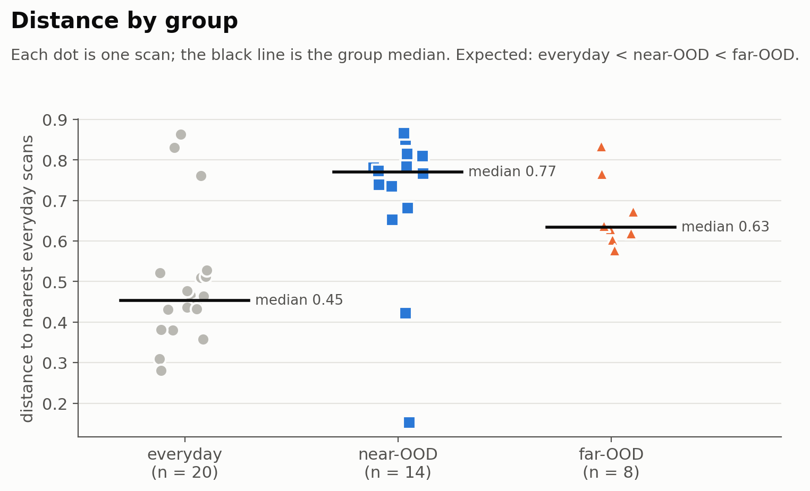

*The same distances by group; black line = median.*

| group | count | median | min | max |
|---|---|---|---|---|
| everyday | 20 | 0.454 | 0.281 | 0.864 |
| near_ood | 14 | 0.77 | 0.153 | 0.865 |
| far_ood | 8 | 0.634 | 0.578 | 0.834 |

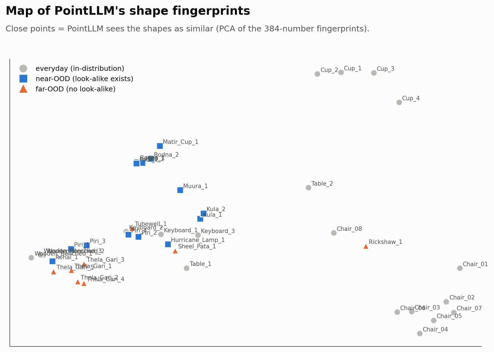

*Map of PointLLM's fingerprints (PCA).*

## 4. Multiple choice (each object's own 4 options)

| set | label | correct | n | accuracy | p_value |
|---|---|---|---|---|---|
| everyday | real scans | 18 | 20 | 0.9 | 0.0 |
| everyday | real, per object (majority) | 5 | 5 | 1.0 | 0.001 |
| everyday | blind: sphere | 1 | 5 | 0.2 | 0.763 |
| everyday | blind: noise | 0 | 5 | 0.0 | 1.0 |
| far_ood | real scans | 0 | 8 | 0.0 | 1.0 |
| far_ood | real, per object (majority) | 0 | 4 | 0.0 | 1.0 |
| far_ood | blind: sphere | 0 | 4 | 0.0 | 1.0 |
| far_ood | blind: noise | 0 | 4 | 0.0 | 1.0 |
| near_ood | real scans | 0 | 14 | 0.0 | 1.0 |
| near_ood | real, per object (majority) | 0 | 8 | 0.0 | 1.0 |
| near_ood | blind: sphere | 0 | 8 | 0.0 | 1.0 |
| near_ood | blind: noise | 0 | 8 | 0.0 | 1.0 |

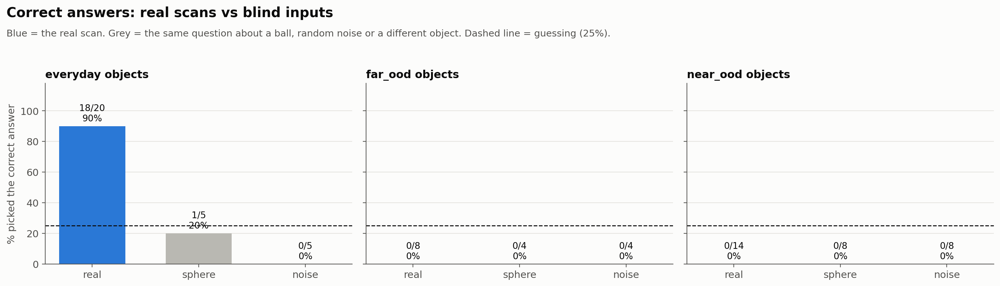

*Real scans vs ball and noise. Dashed line = guessing (25 %).*

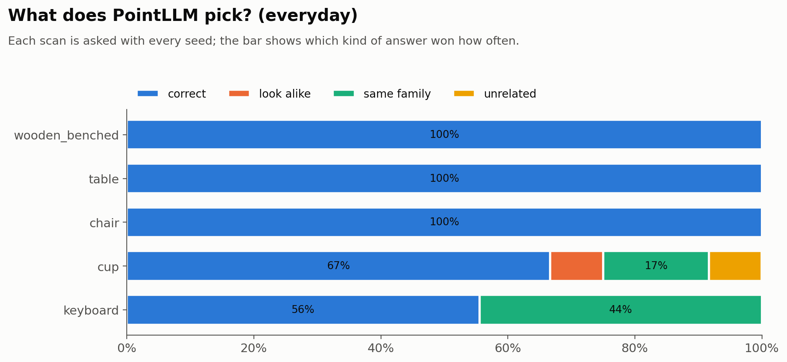

*Which kind of answer wins (everyday).*

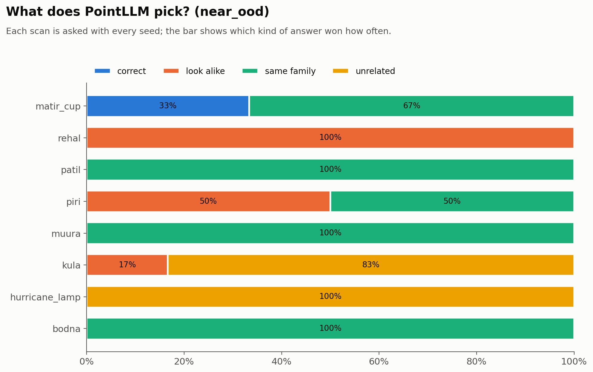

*Which kind of answer wins (near_ood).*

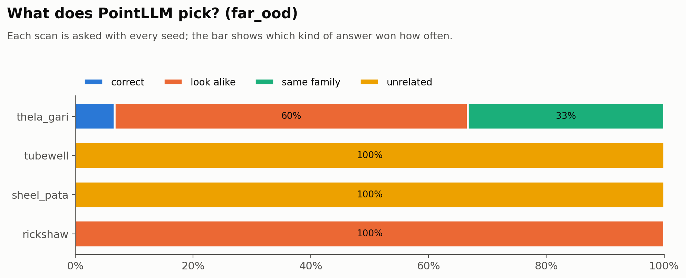

*Which kind of answer wins (far_ood).*

| set | file | pick_text | pick | seeds_agreeing |
|---|---|---|---|---|
| everyday | Chair_01_cleaned.ply | chair | correct | 3 |
| everyday | Chair_02_cleaned.ply | chair | correct | 3 |
| everyday | Chair_03_cleaned.ply | chair | correct | 3 |
| everyday | Chair_04_cleaned.ply | chair | correct | 3 |
| everyday | Chair_05_cleaned.ply | chair | correct | 3 |
| everyday | Chair_06_cleaned.ply | chair | correct | 3 |
| everyday | Chair_07_cleaned.ply | chair | correct | 3 |
| everyday | Chair_08_cleaned.ply | chair | correct | 3 |
| everyday | Cup_1_cleaned.ply | cup | correct | 3 |
| everyday | Cup_2_cleaned.ply | cup | correct | 3 |
| everyday | Cup_3_cleaned.ply | cup | correct | 2 |
| everyday | Cup_4_cleaned.ply | chair | unrelated | 1 |
| everyday | Keyboard_1_cleaned.ply | laptop | same_family | 3 |
| everyday | Keyboard_2_cleaned.ply | keyboard | correct | 3 |
| everyday | Keyboard_3_cleaned.ply | keyboard | correct | 2 |
| everyday | Table_1_cleaned.ply | table | correct | 3 |
| everyday | Table_2_cleaned.ply | table | correct | 3 |
| everyday | Wooden_Benched_1_cleaned.ply | bench | correct | 3 |
| everyday | Wooden_Benched_2_cleaned.ply | bench | correct | 3 |
| everyday | Wooden_Benched_3_cleaned.ply | bench | correct | 3 |
| far_ood | Rickshaw_1.ply | tricycle | look_alike | 3 |
| far_ood | Sheel_Pata_1_cleaned.ply | chair | unrelated | 3 |
| far_ood | Thela_Gari_1_cleaned.ply | wagon | same_family | 3 |
| far_ood | Thela_Gari_2_cleaned.ply | table | look_alike | 3 |
| far_ood | Thela_Gari_3_cleaned.ply | wagon | same_family | 2 |
| far_ood | Thela_Gari_4_cleaned.ply | table | look_alike | 3 |
| far_ood | Thela_Gari_5_cleaned.ply | table | look_alike | 3 |
| far_ood | Tubewell_1_cleaned.ply | chair | unrelated | 3 |
| near_ood | Bodna_1_cleaned.ply | vase | same_family | 3 |
| near_ood | Bodna_2_cleaned.ply | vase | same_family | 3 |
| near_ood | Hurricane_Lamp_1_cleaned.ply | chair | unrelated | 3 |
| near_ood | Kula_1_cleaned.ply | chair | unrelated | 2 |
| near_ood | Kula_2_cleaned.ply | chair | unrelated | 3 |
| near_ood | Matir_Cup_1_cleaned.ply | bowl | same_family | 2 |
| near_ood | Muura_1_cleaned.ply | chair | same_family | 3 |
| near_ood | Patil_1_cleaned.ply | bowl | same_family | 3 |
| near_ood | Patil_2_cleaned.ply | bowl | same_family | 3 |
| near_ood | Piri_1_cleaned.ply | bench | same_family | 3 |
| near_ood | Piri_2_cleaned.ply | bench | same_family | 3 |
| near_ood | Piri_3_cleaned.ply | box | look_alike | 3 |
| near_ood | Piri_4_cleaned.ply | box | look_alike | 3 |
| near_ood | Rehal_1_cleaned.ply | bench | look_alike | 3 |

## 5. All-labels test and confusion matrix

| group | scans | top1 | top3 | score |
|---|---|---|---|---|
| everyday | 20 | 14 | 17 | plain |
| near_ood | 14 | 0 | 2 | plain |
| far_ood | 8 | 0 | 0 | plain |
| everyday | 20 | 5 | 12 | calibrated |
| near_ood | 14 | 1 | 5 | calibrated |
| far_ood | 8 | 0 | 0 | calibrated |

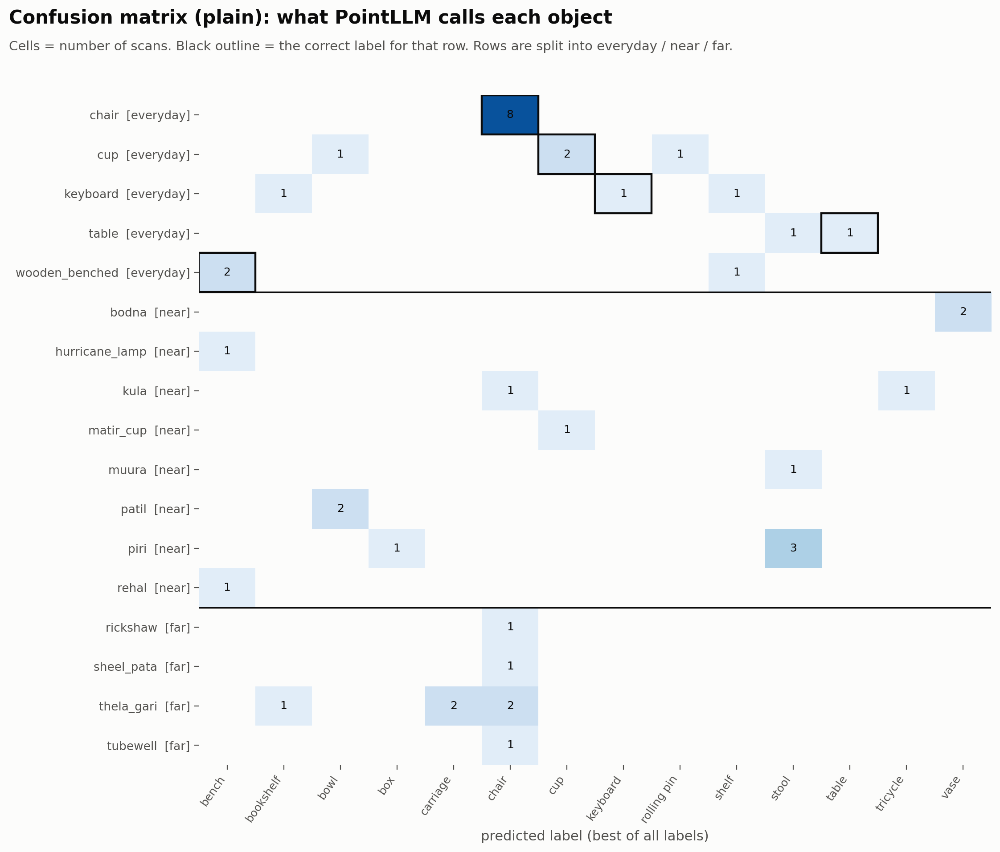

*Plain likelihood. Outline = correct label.*

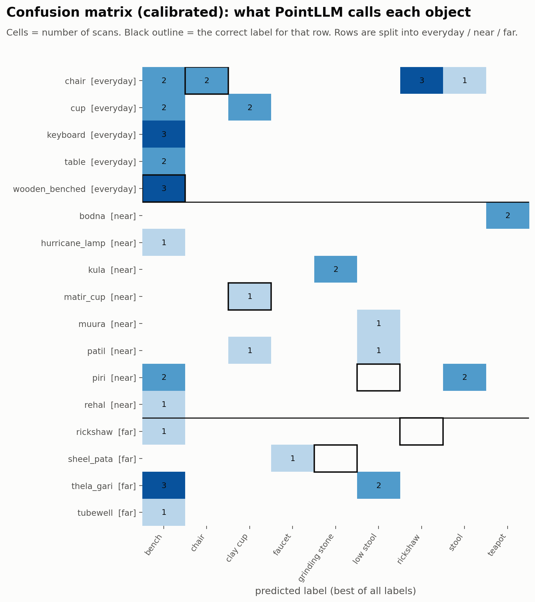

*Calibrated (minus ball/noise). Outline = correct label.*

| group | file | predicted | top3 | correct_label |
|---|---|---|---|---|
| everyday | Chair_01_cleaned.ply | bench | bench, chair, rickshaw | chair |
| everyday | Chair_02_cleaned.ply | stool | stool, chair, rickshaw | chair |
| everyday | Chair_03_cleaned.ply | rickshaw | rickshaw, chair, bench | chair |
| everyday | Chair_04_cleaned.ply | rickshaw | rickshaw, low stool, chair | chair |
| everyday | Chair_05_cleaned.ply | chair | chair, stool, bench | chair |
| everyday | Chair_06_cleaned.ply | bench | bench, rickshaw, book stand | chair |
| everyday | Chair_07_cleaned.ply | rickshaw | rickshaw, bench, chair | chair |
| everyday | Chair_08_cleaned.ply | chair | chair, rickshaw, bench | chair |
| everyday | Cup_1_cleaned.ply | clay cup | clay cup, faucet, bench | cup |
| everyday | Cup_2_cleaned.ply | clay cup | clay cup, faucet, bench | cup |
| everyday | Cup_3_cleaned.ply | bench | bench, grinding stone, clay cup | cup |
| everyday | Cup_4_cleaned.ply | bench | bench, tray, faucet | cup |
| everyday | Keyboard_1_cleaned.ply | bench | bench, grinding stone, cutting board | keyboard |
| everyday | Keyboard_2_cleaned.ply | bench | bench, keyboard, shelf | keyboard |
| everyday | Keyboard_3_cleaned.ply | bench | bench, grinding stone, cutting board | keyboard |
| everyday | Table_1_cleaned.ply | bench | bench, table, book stand | table |
| everyday | Table_2_cleaned.ply | bench | bench, stool, low stool | table |
| everyday | Wooden_Benched_1_cleaned.ply | bench | bench, shelf, low stool | bench |
| everyday | Wooden_Benched_2_cleaned.ply | bench | bench, low stool, stool | bench |
| everyday | Wooden_Benched_3_cleaned.ply | bench | bench, low stool, shelf | bench |
| far_ood | Rickshaw_1.ply | bench | bench, grinding stone, faucet | rickshaw |
| far_ood | Sheel_Pata_1_cleaned.ply | faucet | faucet, bench, low stool | grinding stone |
| far_ood | Thela_Gari_1_cleaned.ply | bench | bench, rickshaw, low stool | push cart |
| far_ood | Thela_Gari_2_cleaned.ply | low stool | low stool, bench, rickshaw | push cart |
| far_ood | Thela_Gari_3_cleaned.ply | bench | bench, rickshaw, low stool | push cart |
| far_ood | Thela_Gari_4_cleaned.ply | low stool | low stool, bench, rickshaw | push cart |
| far_ood | Thela_Gari_5_cleaned.ply | bench | bench, low stool, grinding stone | push cart |
| far_ood | Tubewell_1_cleaned.ply | bench | bench, faucet, rickshaw | hand pump |
| near_ood | Bodna_1_cleaned.ply | teapot | teapot, faucet, bench | water jug |
| near_ood | Bodna_2_cleaned.ply | teapot | teapot, low stool, faucet | water jug |
| near_ood | Hurricane_Lamp_1_cleaned.ply | bench | bench, faucet, book stand | lantern |
| near_ood | Kula_1_cleaned.ply | grinding stone | grinding stone, cutting board, bench | bamboo tray |
| near_ood | Kula_2_cleaned.ply | grinding stone | grinding stone, bench, cutting board | bamboo tray |
| near_ood | Matir_Cup_1_cleaned.ply | clay cup | clay cup, bench, cup | clay cup |
| near_ood | Muura_1_cleaned.ply | low stool | low stool, stool, bench | cane stool |
| near_ood | Patil_1_cleaned.ply | clay cup | clay cup, teapot, bamboo tray | cooking pot |
| near_ood | Patil_2_cleaned.ply | low stool | low stool, bench, clay cup | cooking pot |
| near_ood | Piri_1_cleaned.ply | bench | bench, low stool, stool | low stool |
| near_ood | Piri_2_cleaned.ply | stool | stool, low stool, bench | low stool |
| near_ood | Piri_3_cleaned.ply | bench | bench, low stool, tray | low stool |
| near_ood | Piri_4_cleaned.ply | stool | stool, bench, low stool | low stool |
| near_ood | Rehal_1_cleaned.ply | bench | bench, low stool, stool | book stand |

## 6. How sure is PointLLM? (confidence)

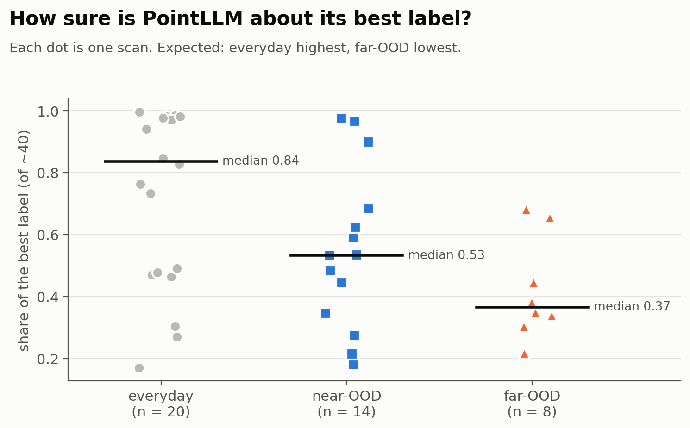

*Share of the best label among all labels; lower = less sure.*

| group | count | median | min | max |
|---|---|---|---|---|
| everyday | 20 | 0.837 | 0.169 | 0.997 |
| near_ood | 14 | 0.533 | 0.18 | 0.976 |
| far_ood | 8 | 0.366 | 0.218 | 0.682 |

## 7. How to read this

- **Far-OOD is confirmed** if far-OOD scans are farthest from the everyday scans, PointLLM is least sure about them, and its labels for them are scattered or unrelated.
- **Near-OOD** objects should go to their look-alike (rehal -> bench), with the shape still pointing that way after calibration.
- Small groups (3 far-OOD scans): read the dots, not just the medians. One scan can move a median.
- Raw tables are in tables/; every chart is in figures/.
