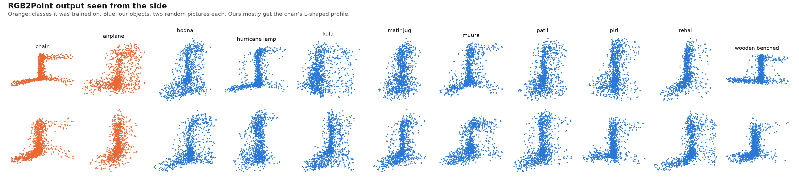
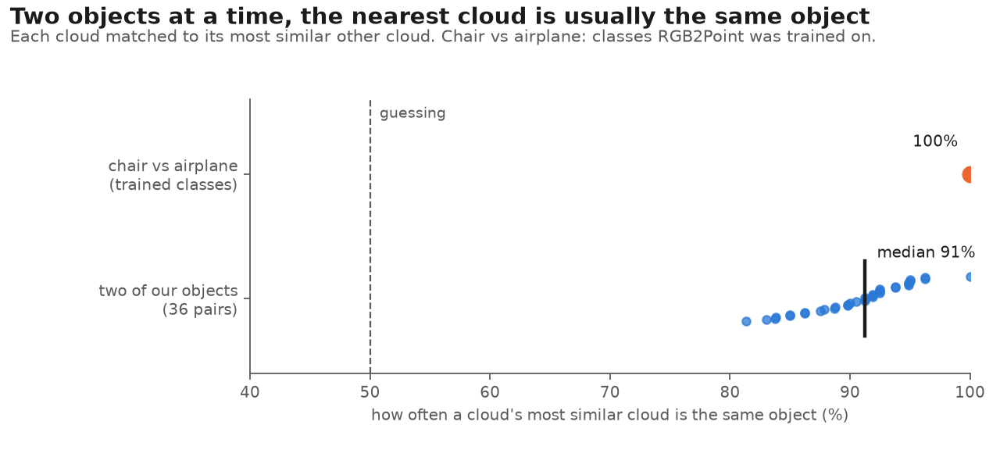
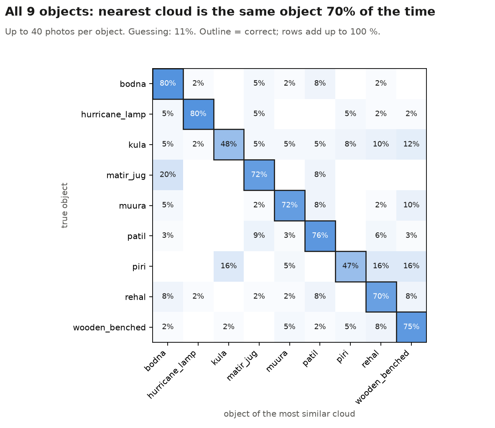

# RGB2Point on web photos of Bangladeshi objects

LocalPoint3D · Track 3, Group 2 · 17 Nov 2026 · run on a laptop CPU with the released checkpoint

## 1. Summary

- We collected **2,250** web photos of 9 Bangladeshi objects and kept **695** after checking them by eye. We also added 93 photos of chairs and airplanes, two classes RGB2Point was trained on, as a control.
- RGB2Point turned all **788** photos into 1,024-point clouds. Seen from the side, most clouds of our objects look like a **chair**: the checkpoint only knows chairs, airplanes and cars.
- Still, the clouds are not random. With all 9 objects together, a cloud's most similar other cloud is the same object **70%** of the time. Guessing would give 11%. With two objects at a time it is 81%–100% (median 91%), and chair vs airplane is 100%.
- This is not just near-copies of the same web photo: without them it is still 68%. Nor is it plain photo colours: comparing tiny thumbnails of the photos gives only 42%.
- **What it means:** the clouds keep a trace of what the photo showed, enough to match photos of the same object, but they do **not** show the object's real shape. They are a fingerprint of the photo, not 3D data of a bodna or a rehal.

## 2. What we did

- **Photos:** Bing and DuckDuckGo image search with several phrases per object (`data/web_image_queries.csv`, script `src/web_images.py`). Google Images does not answer scripts. Every photo was checked by eye; about 1 in 3 was usable (other objects, adverts, collages removed).
- **Model:** RGB2Point (Lee et al.), released checkpoint `pc1024_three.pth`, trained on ShapeNet chairs, airplanes and cars. One photo in, 1,024 xyz points out, no colour. No training or fine-tuning by us.
- **Chamfer distance:** how far apart two clouds are. For every point, take the distance to the nearest point of the other cloud, then average. 0 means identical.
- **Nearest-neighbour test:** for each cloud, find the most similar other cloud (smallest Chamfer distance) and check whether it shows the same object. Up to 40 photos per object (patil 34, piri 19), chosen at random with a fixed seed.

| object | group | photos | in test | within object | to other objects | ratio |
|---|---|---|---|---|---|---|
| wooden_benched | ours | 142 | 40 | 0.032 | 0.032 | 1.015 |
| muura | ours | 103 | 40 | 0.029 | 0.031 | 1.083 |
| rehal | ours | 98 | 40 | 0.026 | 0.03 | 1.14 |
| bodna | ours | 88 | 40 | 0.024 | 0.028 | 1.196 |
| hurricane_lamp | ours | 79 | 40 | 0.027 | 0.03 | 1.136 |
| matir_jug | ours | 72 | 40 | 0.027 | 0.029 | 1.09 |
| kula | ours | 60 | 40 | 0.032 | 0.031 | 0.99 |
| airplane | control | 53 | 40 | 0.026 | 0.034 | 1.294 |
| chair | control | 40 | 40 | 0.025 | 0.034 | 1.321 |
| patil | ours | 34 | 34 | 0.028 | 0.03 | 1.068 |
| piri | ours | 19 | 19 | 0.03 | 0.031 | 1.041 |

Average Chamfer distance between two clouds of the same object, and to clouds of other objects. For our objects the ratio is about 1.0–1.2: on average, two bodna clouds are almost as far apart as a bodna and a muura. For the control classes it is 1.3.

## 3. What the clouds look like

*Side view of RGB2Point's output. Orange: classes it was trained on. Blue: two random photos of each of our objects. Most of ours get the chair's L-shaped profile (seat and back).*

## 4. Can the clouds tell our objects apart?

*Two objects at a time. Guessing = 50 %. Hardest pairs: piri vs wooden benched 81%, kula vs piri 83%, kula vs patil 84%.*

*All 9 objects at once. Rows: true object; columns: object of the most similar cloud. Best: hurricane lamp 80%; worst: piri 47%.*

## 5. Two cheap explanations, checked

| test | result |
|---|---|
| RGB2Point clouds, nearest other cloud | 0.703 |
| same, but near-copy pictures not allowed as partner | 0.682 |
| no 3D: nearest picture by 32x32 colour thumbnail | 0.42 |
| share of nearest-cloud partners that are near-copy pictures | 0.048 |
| guessing | 0.112 |

- **Near-copies:** the web has many copies of the same product photo. Only 5% of the matches were near-copies, and excluding them barely changes the score.
- **Photo colours and layout:** matching the photos themselves as 32×32 thumbnails is much worse than matching the clouds. So RGB2Point's image encoder passes on more than colours. A stronger image model (e.g. CLIP) would probably match the photos even better, which is the point of the next step.

## 6. What this means for the project

- RGB2Point clouds of our objects should **not** be used as 3D scans or fed to PointLLM as if they were our objects: PointLLM would mostly see a chair.
- The reviewed photos are useful as they are: real photos of the 9 objects for **CLIP / MetaCLIP** zero-shot tests and for captions.
- Getting 3D from photos would need a model trained on many kinds of objects. We tried TripoSR on a laptop CPU, but it ran out of resources, so it would need Colab with a GPU.

## 7. Limits

- Web photos are not checked for licences. They are kept out of git and out of this report; only model output is shown.
- Patil (34) and piri (19) have few usable photos; their results are less certain.
- Same-object photos come from different angles. A model that gives views in the camera's frame would make even good clouds of the same object differ, so the nearest-neighbour test is a strict test.
- Numbers come from one random sample of up to 40 photos per object (seed 0).

Files: tables in `results/rgb2point/`, code in `reports/build/rgb2point_eval.py`, notes in `journal/06_rgb2point_web_images.md`.
